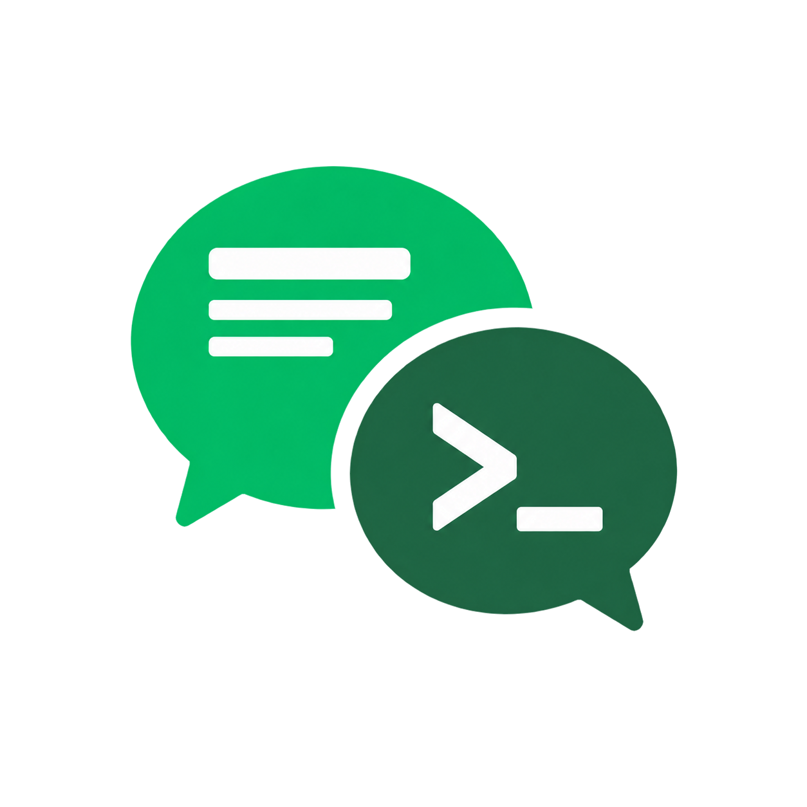

<p align="center">
  <picture>
    <source media="(prefers-color-scheme: dark)" srcset="assets/brand/mpctl-logo-dark.png" />
    
  </picture>
</p>

# mpctl

**给 AI Agent 用的微信公众号草稿编辑工具。**

Agent 在本地处理 HTML、JSON 和图片，mpctl 通过已登录的 Chrome 操作公众号编辑器，完成排版、配图和草稿保存。

## 能做什么

| 能力 | 命令 |
| --- | --- |
| 打开已有草稿或新建草稿 | `article list`、`article open`、`article new` |
| 拉取和写入正文 HTML | `article pull`、`article push` |
| 修改标题、作者和摘要 | `article inspect`、`article update` |
| 上传图片、取得正文图片 HTML、设置封面 | `asset upload`、`asset resolve`、`article cover` |
| 显式保存草稿 | `article inspect --all`、`article save --expect` |

正文、字段和图片操作不会自动保存；mpctl 不会发表文章或发送预览。

## 安装

运行需要 **Bun 1.3.14 或更新版本**和 Chrome/Chromium。

```sh
npm install -g mpctl
export MPCTL_PAIRING_CREDENTIAL='replace-with-a-private-token'
mpctl connect --extension '<扩展ID>'
```

扩展从 [GitHub Releases](https://github.com/c-w-xiaohei/mpctl/releases/latest) 下载 `mpctl-extension-v<版本>.zip`，解压后在 `chrome://extensions` 开启开发者模式，选择“加载已解压的扩展程序”，即可取得扩展 ID。`connect` 会按需启动 broker；未连接时以非零状态返回连接指引。

首次配对需要在该扩展的后台控制台写入配置，凭证与上面的环境变量保持一致：

```js
await chrome.storage.local.set({
  websocketUrl: "ws://127.0.0.1:17381/bridge",
  pairingCredential: "replace-with-the-same-private-token",
});
```

随后点击扩展弹出页的“发起连接”，用 `mpctl status` 确认连接，并在该浏览器中自行登录公众号后台。配对凭证只保存在本机，不要贴到公开日志中。

## 让 Agent 使用

具备终端和文件读写能力的 Agent 可以直接调用 CLI，结果以 JSON 返回。可以这样交代任务：

> 用 `body.html` 和 `fields.json` 修改指定草稿，上传 `hero.png` 作为正文配图和封面，最后保存为草稿，不要发表。

命令入口是 `mpctl --help`，具体参数查看 `mpctl <command> --help`。操作结果不确定时，用 `mpctl operation status '<原操作ID>'` 查询，不要直接重做。

## 开发运行

需要 **Bun 1.3.14** 和**支持 MV3 的 Chrome/Chromium**。以下步骤用于从源码运行开发环境。

在仓库根目录：

```sh
bun install --frozen-lockfile
bun run build
export MPCTL_PAIRING_CREDENTIAL='replace-with-a-private-token'
```

另开终端，在 `packages/extension` 启动扩展开发服务并保持运行：

```sh
bunx wxt --host 127.0.0.1 --port 3000
```

1. 在 `chrome://extensions` 开启开发者模式，加载 `packages/extension/.output/chrome-mv3-dev`。
2. 回到仓库根目录，运行 `bun run packages/cli/src/main.ts connect --extension '<扩展ID>'`，启动本地 broker。未连接时会返回连接指引，并以非零状态退出。
3. 打开扩展弹出页的“开发调试”，填入 `ws://127.0.0.1:17381/bridge` 和相同凭证，点击“发起连接”。
4. 在该浏览器中登录公众号后台，再用 `bun run packages/cli/src/main.ts status` 确认连接。

源码开发时，将命令示例中的 `mpctl` 替换为 `bun run packages/cli/src/main.ts`。`bun run build` 的生产扩展产物位于 `packages/extension/.output/chrome-mv3`；不要同时启用生产版和开发版扩展。

## 开发检查

```sh
bun run typecheck
bun run lint
bun run test
bun run test:browser
bun run build:cli
bun run build:extension
bun run test:package
```

CLI／broker 日志可用 `MPCTL_NEXUS_DEBUG=1` 开启。扩展开发日志默认开启，启动 WXT 前设置 `VITE_MPCTL_NEXUS_DEBUG=0` 可关闭。

发布统一由 `Release` CI/CD 完成：改动时用 `bun run changeset` 记录受影响的 CLI／插件，合入 `main` 后自动生成版本 PR；合并版本 PR 后，CI 自动将 CLI 发布到 npm、插件 ZIP 发布到 GitHub Release。两者分别管理版本，无需手填版本、保存 npm token 或手动上传附件。broker 和 contracts 是内部包，不单独发布。

---

mpctl 是独立的非官方项目，与腾讯或微信无隶属关系，也未获得其背书。
