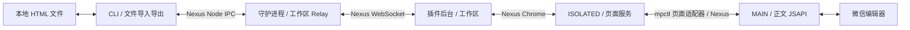

# RFC 0003：插件工作区与页面通信适配器

- 状态：四包实现与当前完整离线浏览器回归已通过；真实纯 CLI 新稿散文正文往返和已存草稿只读打开/拉取通过。工作组持久锁定与重复组清理已真实验证，成稿保留。未验证真实已存稿写入、显式保存/发表或原子性；其他登录/权限模式、稳定条目身份和普遍页面兼容仍未验证。
- 作者：mpctl 维护者
- 创建日期：2026-09-11

## 1. 目标与决策

本规格定义文件驱动正文编辑所需的插件工作区、文章定位、内部页面服务和 MAIN 通信适配器。通信拓扑见 [RFC 0001](./0001-communication-architecture.zh.md)，扩展生命周期见 [RFC 0002](./0002-mp-extension-development-and-release-flow.zh.md)，agent-facing 文件工作流见 [RFC 0004](./0004-article-and-assets-workflow.zh.md)。

已确定：

1. agent 通过 CLI 将正文拉取为本地 HTML，编辑文件后推送；mpctl 不提供正文 patch、光标、选区或段落修改协议。
2. CLI 读写本地文件；插件接收或返回 HTML，不解释本地路径。
3. 插件后台提供稳定工作区服务，维护一个工作标签组、按需打开页面并解析文章引用。守护进程只 Relay 唯一插件的工作区入口。
4. 内容脚本负责页面识别、条目绑定及 DOM 能力，MAIN 常驻访问正文 JSAPI。读取使用 `get_content`，推送使用 `set_content`。
5. 页面通信适配器位于扩展内部，建议文件为 `packages/extension/src/transport/page-bridge.ts`，不强制独立目录。以 WXT 共享脚本节点和 `CustomEvent` 示例为起点封装 Nexus Endpoint/Port，不增加第二套 RPC，不逐次执行脚本。
6. 推送携带调用者上次看到的实际正文 `expectedHash`，MAIN 排队并比较当前 HTML hash 后整体替换，成功回读规范化正文的新 hash。不增加合并、强制备份或持久操作日志；断线或超时后的旧写入不自动重放。

上述常驻 MAIN 与“不逐次执行脚本”针对正文 JSAPI 桥。自动导航另由扩展 `chrome.scripting.executeScript({ world: "MAIN" })` 执行自包含、短时的原生控件目标捕获；它不读取/写入正文，不传递配对配置，不提供通用脚本 RPC。目标经后台校验后由 Chrome 标签 API 打开。

## 2. 运行时与服务分布

工作标签组 ID 持久化于扩展 `storage.local`，`storage.session` 仅用于旧版指针迁移及临时文档提示。后台/浏览器重启先核对已锁定组；只有 Chrome 明确返回该 ID 不存在才寻找既有 `mpctl` 组并重新锁定，最后才新建。未知 Chrome 错误不触发建组。`workspace cleanup` 由插件执行合并重复 `mpctl` 组，移动标签而不关闭稿件或改写正文。



| 边界              | 实际职责                                           |
| ----------------- | -------------------------------------------------- |
| agent → CLI       | 文章选择与文件拉取/推送，必要结果与动作提示        |
| CLI → 守护进程    | 连接状态及工作区服务通路                           |
| 工作区 → 页面服务 | 将文章引用解析为精确页面和图文条目，组织浏览器操作 |
| 内容脚本 → MAIN   | 调用只能在页面主环境访问的正文 JSAPI               |

工作区是真正的业务入口：当前实现可新建空白编辑页，也可在受限的单条当前图文范围内发现并打开已存草稿后执行正文文件 I/O。它使用不透明草稿组候选，经卡片“编辑”入口打开并核对 `appmsgid`，另行生成临时文章引用；不提供稳定条目 ID。仅已观察登录超时页可按完整标志组合分类，其他登录/权限模式不支持分类。页面管理是插件内部模块，不另做一套浏览器控制 RPC。agent 决定内容与排版，CLI 负责文件 I/O，守护进程不接管浏览器业务。

### 2.1 Relay 布局

守护进程在 IPC 实例上注册工作区 Token 的 Relay，下游固定为唯一已准入的插件 WS 会话。插件后台是工作区的实际 provider；文章引用作为普通参数传递，由工作区经 Nexus Chrome 调用对应 document 的页面能力。

不为每篇文章注册 Token，不轮流将编辑页注册成一个全局 EditorToken，也不以当前激活 tab 隐式决定写入对象。文章引用可以用于后续 CLI 命令，不依赖前一次 CLI 的远程 Ref 生命周期；实际可用性仍取决于插件的文章定位信息。

MAIN 提供正文 Token，content 用 Nexus Relay 将它挂载到 Chrome 实例，保留本地 DOM 服务。正文调用前的路由、登录、当前项条件由 content `policy.canCall` 和 MAIN 调用前守卫核对，不再用手写 get/set 转发包装。hash 比较、文档内写入排队和规范化回读属于 MAIN provider。

background 的 Chrome 通信域只有一个命名实例，页面方法用 `connect({target})` 获取精确文档会话，由 Nexus 复用有效会话。`get(Token)` 不拨号、不等待未来 provider。content 注册 Relay 后 `updateIdentity({app:{editorReady:true}})`，background 通过 `subscribeIdentity` 观察业务就绪；同一连接不会用第二次 connect 充当就绪通知。popup 每次显式操作重新 connect/get，不缓存已失效的成功 proxy。

### 2.2 各运行时持有的状态

| 运行时   | 状态                                                             |
| -------- | ---------------------------------------------------------------- |
| CLI      | 本次文章引用、文件路径、输入或返回的 HTML                        |
| 守护进程 | 唯一插件身份、连接状态、Nexus 实例及 RelayHandle                 |
| 插件后台 | 标签组、受管页面用途、文章定位信息、当前 document 绑定和页面代理 |
| 内容脚本 | 当前页面与条目事实、MAIN 页面桥连接                              |
| MAIN     | 当前编辑器绑定、JSAPI 调用和回调                                 |

守护进程不复制文章路由表，不保存正文工作副本。插件不建立第二份长期文章数据库。

## 3. 工作标签组、文章定位与生命周期

### 3.1 工作页面

插件按需创建并锁定一个 `mpctl` 标签组。并发的组校验/创建/恢复合并为一轮；只有 Chrome 明确确认原 ID 不存在才恢复或新建，未知故障保留线索供后续显式请求核对。草稿列表页的并发发现共用一轮，失败后重新核对。list 的 `candidate` 来自实际草稿组定位，不使用随机注册表、代际或全表清空；open 重新检查当前列表中的唯一对应组。再次 list、失败 list 和后台重启不会自行撤销组定位值，但目标在当前列表不存在或不唯一时不可打开。

标签组只组织页面，不隔离 Cookie 或账号。组名称不是所有权证据，不因同名就接管其他组。整理工作区不自动关闭可能有未保存内容的编辑页。

插件未连接时，CLI 提示运行显式 `connect` 命令，也可使用插件连接界面；connect 返回 instruction 与连接页 URL，由 agent 按浏览器实际运行环境打开，扩展按已存配置发起连接，CLI 不启动浏览器。插件连接后工作区可新建空白编辑页。仅已观察登录超时页的完整标志组合返回登录专属失败；其他登录/权限模式不作登录结论，空列表歧义失败关闭。

### 3.2 文章引用与页面绑定

目标模型中，文章引用如 `a1` 标识工作区中选定的文章，不冒充微信永久文章 ID。当前实现为新建空白页或成功打开的已存草稿生成临时文章引用；已存草稿先使用与文章引用不同的不透明组候选。候选/文章引用与当前页面绑定分开：

```text
文章引用
  → 账号上下文及文章定位信息
  → 当前页面绑定（可能尚未打开）

工作页面
  → 页面用途
  → tab/document
  → 当前图文条目及页面服务连接
```

一个编辑页可能包含多条图文。目标设计要求确定具体文章条目，不能仅以 URL、标题或 tabId 判断文章身份。当前已存草稿路径核对 `appmsgid`、页面/路由绑定，并要求所有 `.js_appmsg_item` 中恰好一个可见，且是 `.current[data-msgindex="0"]`；第二个可见的非当前项也会导致拒绝。该索引不是稳定条目 ID。正文版本以编辑器实际 BODY HTML 的 UTF-8 SHA-256 表示；交互事件不参与版本判断。现有证据不证明平台程序性切换都可检测，也不保证正文检查与写入之间的原子性；离线 E2E 仅验证合成单条及歧义拒绝。

发放新稿/已存稿的临时引用前，工作区读取当前 BODY HTML，返回 UTF-8 SHA-256 `bodyHash`，随后复核页面和目标事实。引用表只保存定位绑定；调用者在 push 中显式传自己的 `expectedHash`，不依赖服务器可变 baseline。页面核对不是原子快照。

对新稿，初次就绪之后、发放引用以及正文读写派发之前还会复核原文档的页面状态。末段已确认换页返回 `target_unavailable`，未知 Chrome 核对故障返回 `page_failed`；仅仍在原页且出现完整已观察登录超时标志时返回 `not_logged_in`，当前但不再 ready 时返回 `page_failed`。引用或正文操作在这些检查后才发起，已派发的正文写入失败仍返回 `write_unknown`；检查与页面变化之间不具备原子性。

Nexus Chrome 优先使用 `chromeTarget.contentDocument({ tabId, documentId })` 定位文档；文章条目和编辑器绑定由页面业务检查，不混入 adapter 未声明的地址字段。tab/document 和内部绑定信息不要求 agent 提供。

对受管 tab 的异步 Chrome 查询完成后，当前实现再次核对最新观察到的 document、路由身份及内部路由版本；同一 document 的分页或编辑页组标识变化也会令旧 binding 失效。若页面管理器观察到 A→B→A，旧 binding 不会在返回 A 后复活；仅上下文查询参数变动不增加版本。即使 Chrome 查询失败，只要已观察到来源文档或路由变化也会判定旧绑定失效；未确认变化的 Chrome 查询故障则保留为页面失败。草稿组读取固定使用已选中的列表绑定，读取前后重查来源，已确认失效时不给候选或继续打开。未经页面管理器观察的短暂切换仍无法检测，也不保证异步核对与实际操作原子化。

列表卡片 Edit 控件定位及可见性确认后，内容脚本在同步点击前再次核对原路由、组唯一性与完整的已观察登录超时标志；若此时出现该标志便不点击。该次打开沿现有目标不可用路径失败，后续后台状态调用仍可报告明确的 `not_logged_in`。已派发的点击不能撤销，也不据此识别其它登录/权限页面。

正文页面服务的 get/set 在转发至 MAIN JSAPI 之前也同步读取当前文档的完整登录超时标志，防止标志已出现但 MutationObserver 回调尚未更新缓存时继续转发；原路由/唯一当前项核对继续生效。写入前先比较实际 HTML hash；差异返回结构化 `content_conflict` 且不调用 set。JSAPI 没有 compare-and-set，因此两次操作之间仍存在小的检查/写入竞态；已派发写入的未知结果仍返回 `write_unknown`，读取失败走 `page_failed`。

- 当前：已存草稿 list/open 限于观察到的列表卡片及“编辑”入口；组定位由 open 当次重查，不是永久文章标识。
- 未保存的新稿可能只存在于页面中，不能假定关闭后可恢复。
- 页面刷新或导航使旧页面代理失效，但不必然使文章本身失效。
- 目标行为：无法确认原文章时明确失败，不静默换目标。当前核对已观察路由与条目结构；点击、滚动等交互本身不撤销引用。登录判断仅覆盖完整已观察超时标志，其他登录/权限模式与原子性未验证。
- 同页需要切换条目的操作，由插件业务层组织顺序；排队或背压属于内部实现，不建立锁服务。

### 3.3 存储归属

| 数据                                             | 保存位置                            | 使用原则                                                     |
| ------------------------------------------------ | ----------------------------------- | ------------------------------------------------------------ |
| 正文工作副本                                     | CLI 所在机器的 HTML 文件            | agent 自行编辑和保管                                         |
| WS、Nexus 实例、proxy/ref、RelayHandle、当前调用 | 所属运行时内存                      | 不序列化，不复活旧调用                                       |
| 工作组锁                                         | 插件 `storage.local`                | 重启后核对 Chrome 的实际组，旧 session 值只作迁移线索         |
| 受管 tab 及用途                                  | 插件 `storage.session` 中的必要线索 | 后台重启后查询 Chrome 实际状态                               |
| 文章定位信息及当前页面绑定线索（目标设计）       | 插件 `storage.session`              | 核对实际账号、文档和条目后才能继续使用；当前尚未恢复文章引用 |
| 插件配置、连接地址及必要身份配置                 | 插件 `storage.local`                | 保留配置不等于允许自动连接                                   |
| 当前正文、文章字段和就绪状态                     | 微信页面，操作时读取                | 不长期缓存完整文章或 DOM 引用                                |
| 公众号登录态                                     | 浏览器和微信页面                    | 不另存永久“已登录”标志或 Cookie 副本                         |

`storage.session` 是恢复线索，不是永久目录。当前 `restore()` 核对工作组，丢弃序列化 document ID，等待 content 重新上报。文章引用表不恢复，旧 ref 字符串不能重建定位。`article current` 可只读核对工作组中唯一已有编辑页并发新引用；多个编辑页拒绝猜选，旧 content bridge 失效时失败，不自动 reload 未保存正文或新建稿。CLI 退出或 WS 断开不清仍存活 background 的表。document 提示异步持久化失败不影响内存同步失效，工作组锁保存失败仍传播。

每次页面操作从同一个 background Nexus 获取精确 tab/document 会话，由 Nexus 负责复用；页面管理器不再另存连接 Promise cache，也不创建只会拨号的 no-op listener 子类。状态返回后重新核对来源，明确换页拒绝旧结果，未知 Chrome 查询故障保留页面失败；不自动重发失败请求或拨号到 broker。

草稿列表的 `listDraftGroups` 在状态读取后还有一次来源核对：核对时已确认文档/分页失效则不给候选（`target_unavailable`），Chrome 当前性查询本身无法确定时沿页面失败返回（`page_failed`）；只有当前性仍确认且命中完整登录超时页标志才返回 `not_logged_in`。该附加核对不会扩大登录/权限页面识别范围。

草稿组读取完成后还会针对原列表绑定重新读取一次状态，并在读取状态前后核对来源：已确认来源失效先返回 `target_unavailable`，未知 Chrome 查询故障走 `page_failed`；仍 current 时新出现的完整登录超时标志返回 `not_logged_in`，状态为 loading 时失败关闭，不把此次空结果冒充已登录空列表。仅状态仍 ready 才返回组结果；这些异步步骤之间没有原子快照。

即使列表页状态仍为 ready，若解析后没有可用组，也返回页面失败，不宣称已登录空草稿箱。只返回非空、唯一且有标题的实际组定位；并发 list 不修改全局候选状态。该行为不构成已登录空列表的正向判据。

已存草稿在验证唯一可见当前项和 `appmsgid` 后，末段再次核对原 tab/document/route；明确失效时拒绝目标，Chrome 查询本身失败且无法确认时按 `page_failed` 传播，不将未知故障当成已确认失效。正文写入派发后的结果未知仍报告 `write_unknown`；末段核对不保证检查与 JSAPI 调用之间的原子性。

已存草稿服务成功读取后还会针对原编辑页重新查询一次状态，并在状态查询前后核对绑定；确认换页优先拒绝旧目标，Chrome 故障不伪装成换页。只有仍在原页且新状态显示完整登录超时标志时返回 `not_logged_in`；状态不再 ready 则不使用此前成功的草稿验证结果。该核对适用于发放临时引用与正文预检，仍不保证到 JSAPI 派发间的原子性。

已存草稿在 ready 和初始正文读取之后复核同一组、编辑页和状态，再发引用。正文读写预检保留 document/route、组及唯一可见当前项检查。content policy 拒绝不再匹配的正文调用，MAIN 在每次 JSAPI 派发前再次检查同步页面事实，避免排队写入跳过边界；这些检查不能撤销已经派发的写入，也不能提供原子快照。

WS 断开撤下 broker 的工作区 Relay，保留 IPC 会话及本地 status；不会关闭工作 tab 或清除仍存活 background 的文章绑定。显式重连重新注册 Relay，后续根调用可获取新上游；旧会话 proxy/ref 与在途调用不复活、不重放。

## 4. 内部正文服务

agent-facing 是文件命令；下面仅表达运行时之间的内部能力，不是另一套要求 agent 使用的修改 API。

| 层次     | 读取                         | 推送                                |
| -------- | ---------------------------- | ----------------------------------- |
| CLI      | 接收 HTML，写入指定文件      | 读取指定文件，传递 HTML             |
| 工作区   | 接收文章引用，定位后获取正文 | 接收文章引用和 HTML，定位后导入正文 |
| 页面服务 | 核对目标条目并调用 MAIN      | 核对目标条目并调用 MAIN             |
| MAIN     | `mp_editor_get_content`      | `mp_editor_set_content`             |

内部方法名称可采用 `getContent/setContent` 等直接命名，具体类型由实现收敛；Token 使用 mpctl 命名空间。工作区服务还负责查找、打开和新建文章，不为每种页面另增对外 Service。

MAIN 的回调式 `invoke` 包装负责成功、错误与超时结果；Nexus 适配器只传输消息，不理解微信 API。MAIN 不接收本地路径、配对凭证或无关页面列表。业务输入与页面返回值使用 Valibot 校验，不重复校验 Nexus 底层帧。

`mp_editor_get_isready` 返回的 `isNew` 表示编辑器实现版本（新版为 `true`），不表示文章是否新建。正文服务仅接受 `isReady: true, isNew: true`；新稿/已存稿的区别由精确路由、已存稿组与当前条目验证表达，不从该版本标志推断文章新旧。

### 4.1 读取和导入

读取返回当前正文 HTML 及其 UTF-8 SHA-256 `bodyHash`；CLI 将 HTML 写入文件，hash 放在 JSON 结果，不创建隐式 sidecar 或文章项目格式。

推送使用完整文件和调用者 `expectedHash`；MAIN 按文档串行检查当前 HTML，冲突不 set，成功返回规范化回读的新 hash。不做 patch、光标插入或远端合并。平台没有原子 CAS，读取与 set 之间仍存在竞态。

微信会规范化 HTML。输入和读回字符串不要求逐字相等，不预先删除微信生成的未知标记；需要读取实际结果时再拉取。推送不自动反写本地源文件。

### 4.2 调用结果

正文写入成功表示编辑器接受更新，不表示原样保留 HTML、视觉排版正确或云端保存。草稿保存和预览是独立操作。

超时或断线不能证明操作未执行；缺乏充分结果时报告未知，不自动重放。关闭连接或释放 Ref 不代表取消微信内部调用。一次回读只说明当前正文，不证明旧调用已经终结。

当前只使用调用者持有的 HTML hash 乐观检查，不定义持久 operationId、日志或强制备份。再次推送旧文件仍须当前 expectedHash，不承诺恢复编辑器撤销栈或其他字段。

## 5. 工程归属

工作区包固定为 `packages/cli`、`packages/broker`、`packages/contracts`、`packages/extension`。具体依赖方向、入口示意和工具链见 RFC 0005；下列是职责落点，不要求每项成为独立模块：

```text
packages/contracts/          # 跨程序 workspace/connection 类型、schema、Token
packages/cli/                 # main、article、connection；命令与本地文件 I/O 同处
packages/broker/              # main、server；Relay 随连接生命周期管理
packages/extension/
  entrypoints/                # WXT 入口与组装
  src/connection.ts           # 插件连接生命周期
  src/workspace.ts            # 文章引用及浏览器业务
  src/pages.ts                # Chrome 页面生命周期
  src/mp/                     # 页面/编辑器 JSAPI 行为
  src/transport/page-bridge.ts # 页面 Nexus 传输适配器（如需独立文件）
```

职责可在规模尚小时合并；不创建空目录或空接口。不要预拆 article manager、独立 Relay/纯转发模块或 FileService。文章引用与浏览器业务归工作区；Chrome 生命周期归 pages；mp 模块处理微信页面与 JSAPI；页面桥只负责 Nexus 传输。页面桥文件不是强制拆分，相关实现可留在合适调用方模块。`contracts` 不承载 Chrome 地址、DOM、Node 服务实现或扩展存储记录；插件内部页面契约留在插件内。

## 6. 页面 Endpoint/Port

### 6.1 加载与接入

以 WXT `injectScript(..., { keepInDom: true, modifyScript })` 路径为设计基线：

1. 内容脚本创建本次页面桥绑定，在插入节点前安装接收监听及最小连接参数。
2. MAIN 通过 `document.currentScript` 获取共享节点，安装反向监听，初始化 Endpoint 与正文 JSAPI provider。
3. 两端准备好传输后将 Port 交给 Nexus Core，由 Core 处理握手和服务授权。不自建业务 ack/error/RPC 帧。
4. 脚本加载、Nexus 就绪、编辑器就绪分别处理，不能互相代替。

初始化接口遵循 Nexus Endpoint/Port 契约。加载失败应报告错误，不静默改为逐次执行脚本。

### 6.2 传输与生命周期

- 两个方向使用独立事件类型和通道标识，防止自收和误收；标识不是同页脚本认证。
- `CustomEvent` 同步派发；发送和接收时复制数据，接收端排队交付，避免在对端调用栈内重入 Core。
- 仅承载 Nexus 要求的数据格式，正确处理 ArrayBuffer、视图及偏移；不依赖跨 realm 的 `instanceof`，不传 DOM、函数或共享可变业务对象。
- 单消息和队列有界，超限明确失败；具体上限由实现确定。
- 关闭幂等，清理监听和队列；WXT 上下文失效及页面生命周期触发清理。节点移除不等于对端已经感知断线。
- MAIN 不重复注册服务及微信监听。用户重新连接 WS 时，只重建失效通信段，仍有效的页面服务可以复用。

生产页面桥已在离线 Chromium 验证跨 world 二进制偏移、顺序、重入、关闭通知和 reload 后重连；同一生产路径也参与了文件工作流 E2E。此证据不验证真实 MP 页面 CSP/兼容性，也不证明同页脚本隔离。MAIN 不接收扩展凭证、文件系统或浏览器特权；同页脚本的可见性不能靠 origin/nonce 消除。

## 7. Nexus 使用约束

- Node IPC、WS、Chrome 和页面桥各使用相应 Nexus 通信域。相同 Token 的透明转发使用 `Nexus.relay({ from, to, services })`；文章定位与开页属于工作区本地业务。
- Relay 注册固定下游目标；守护进程的目标是唯一插件会话，文章切换不改变它。插件断线使旧通路失效，用户重连后重建。
- Relay 转发调用、回调和 ref 并管理资源作用域，两段仍为独立会话。注册成功不等于插件页面已就绪。
- `canConnect/canCall` 分别作用于各段；`where` 只筛选连接，不负责授权。Token 标识服务，target 标识地址，connection 标识实际会话。
- 失效的 proxy/ref 重新取得，不作为普通数据持久化。文章引用是业务定位数据，不是跨 CLI 持久化的远程 Ref。
- 不通过任意 `apiName`、`eval`、`runCommand` 或自定义 WS 隧道绕开明确服务边界。

## 8. 设计状态与边界

正文就绪、读取、替换和 HTML 插入曾在真实页面单独调用；当前产品模型只采用读取与整体导入。已测插入能力不意味着需要保留光标/选区接口。

CLI 的当前目标为自动 `article open/new`：由扩展获取站点原生导航目标并打开编辑页，使用者不处理 attempt，也不借助外部浏览器自动化或人工点击。成功 stdout 只输出最终 JSON，失败 stderr 返回结构化错误。此前“单命令但仍提示人工点击”的版本只是过渡实现；以下真实记录来自更早的手动交接，不能作为当前自动导航版本已通过的证据。纯 CLI 散文实测单独记录于 `tmp/reports/T73-cli-only-essay-acceptance.md`，身份与正文守卫详见 RFC 0004。

当前自动 `article new` 已在真实账号完成 `connect --reload → new → pull → 本地编辑 → push → pull`。正文全文、4 个小节及所核对的关键内联排版保留，输入文件未改写，成稿编辑页保留；未显式保存/发表。自动 saved `list → open → pull` 已真实只读通过，正文私下0600保存且未读取/输出。当前完整浏览器回归2/2通过，包含自动导航正文路径、连接页和保留标签的重复工作组清理；证据独立于历史手动记录。

当前四包实现采用单个 background Chrome Nexus、content DOM provider + MAIN Token Relay、注册后的 editorReady 身份更新。list 不再持有随机候选表或代际，open 重查真实组。正文 hash 比较、写入串行及规范化回读在 MAIN；保留原页面/路由、saved 唯一可见当前项与登录检查。当前隔离验证见 `tmp/reports/T76-nexus-cleanup.md`。T73/T74 的真实 CLI 新稿往返及 saved 只读是此前修订证据，本轮没有操作真实账号；未证明真实 saved 写入、保存/发表、普遍站点兼容或原子 CAS。

参考：[WXT 页面脚本](https://wxt.dev/guide/essentials/content-scripts.html#isolated-world-vs-main-world)、[Nexus Relay](https://c-w-xiaohei.github.io/nexus/docs/relay/)、[Nexus 核心概念](https://c-w-xiaohei.github.io/nexus/docs/concepts/)、[Nexus Chrome](https://c-w-xiaohei.github.io/nexus/docs/chrome/)、[Chrome tabs](https://developer.chrome.com/docs/extensions/reference/api/tabs)、[Chrome tabGroups](https://developer.chrome.com/docs/extensions/reference/api/tabGroups)。
