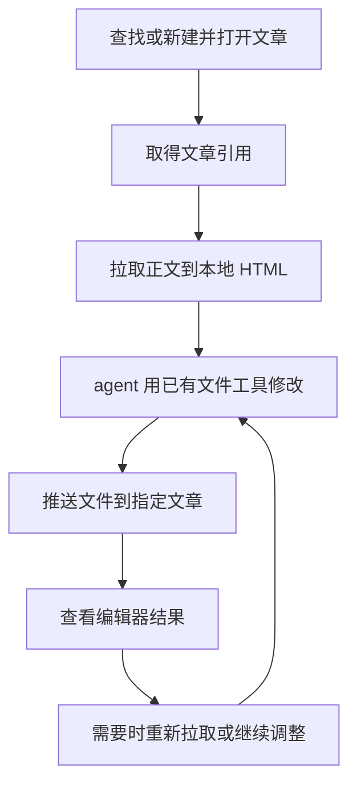

# RFC 0004：文件驱动的正文编辑与排版

- 状态：当前纯 CLI 自动新建在真实账号通过散文 `new → pull → 本地编辑 → push → pull`，完整文本与关键内联排版保留、输入文件不变；自动已存稿 `list → open → pull` 只读通过。当前完整浏览器回归2/2通过。工作组持久化锁定并清理至1组，编辑页保留。未向既有稿件 push，未显式保存或发表。有限样本不证明普遍页面兼容、云端持久化或原子性；其他登录/权限模式及稳定条目身份仍未验证。
- 作者：mpctl 维护者
- 创建日期：2026-09-24

## 1. 目标与范围

mpctl 将公众号文章的当前正文导出为本地 HTML 文件。agent 使用已有的文件读取、搜索和编辑工具完成文字排版，再通过 mpctl 将文件导入指定文章。agent 负责内容和样式，插件负责定位文章与操作页面，微信编辑器负责实际渲染。

当前范围是文字正文的读取、文件编辑和整体导入。图片上传、素材管理和封面暂不纳入当前设计。标题、作者、摘要是独立文章字段，不混入正文文件；其编辑接口另行讨论。保存草稿、预览与发表是独立操作，不隐含于正文推送。

通信架构见 [RFC 0001](./0001-communication-architecture.zh.md)，插件生命周期见 [RFC 0002](./0002-mp-extension-development-and-release-flow.zh.md)，工作区与内部页面服务见 [RFC 0003](./0003-nexus-main-world-editor-bridge.zh.md)。本文替代此前以字段修改接口、素材计划和定位插入为中心的工作流。

## 2. 编辑器模型

```text
编辑页面（一个 tab）
└── 一组图文
    ├── 文章 A
    │   ├── 标题、作者
    │   ├── 正文（富文本编辑器）
    │   ├── 摘要、封面
    │   └── 其他设置
    └── 文章 B …
```

页面存在“增加一条”入口，一页可能容纳多篇文章。编辑页面是操作场所，文章才是业务对象，不能把 tabId 当成单篇文章身份。工作区查找结果应区分图文组与其中的文章，打开后取得明确文章的引用。

正文 JSAPI 只读写正文 HTML，不包含标题、作者、摘要。微信内部维护富文本编辑状态，接收和导出 HTML 时可能规范化节点、属性和样式，并非原样存储一个 HTML 文件。

| 对象         | 作用                                            |
| ------------ | ----------------------------------------------- |
| 文章引用     | 确定浏览器中要操作的文章；由插件工作区解析      |
| 本地文件路径 | 确定 CLI 读写的文件，不承担文章身份             |
| 正文 HTML    | 编辑器正文的交换形式，也是 agent 的本地工作副本 |

正文开头的 `<h1>` 仍属于正文，不自动映射为文章标题。正文推送不会同时修改作者、摘要等控件。

## 3. Agent-facing 文件工作流



目标工作流包含查找/打开和正文文件操作。`article open/new` 各是一次命令：扩展负责获取站点原生导航目标并打开编辑页，目标通过检查后在 stdout 返回 JSON 文章引用；不要求外部浏览器自动化、人工点击或 prepare/complete。列表候选是不透明的草稿组候选；打开后返回不同的临时文章引用用于正文操作。命令示例：

```bash
mpctl article list
mpctl article open <candidate>
mpctl article new
mpctl article current # 只读获取工作组中唯一已有编辑页的新引用，不新建/重载

mpctl article pull <article-reference> --body ./body.html
mpctl article push <article-reference> --body ./body.html --expected-hash <last-observed-sha256>
```

列表候选是实际草稿组定位，`candidate` 字段保持兼容并作为 opaque 值传给 open。重复/失败 list 不撤销它；open 重新取得当前列表并确认唯一对应组，当前页中不存在或歧义的组拒绝导航。文章引用则是 background 内的临时页面绑定，不是永久 MP 条目 ID；CLI 退出或仅 WS 离线不清表，background 重启会丢失定位，旧 ref 字符串不能恢复它。

打开要求已观察列表中的唯一候选，新建要求已登录站点提供的健康首页来源；来源恢复可通过公共站点页面导航，不构造含认证上下文的编辑页 URL。扩展内导航由原生控件或其页面 handler 的目标产生，再使用 Chrome 标签 API 打开；不使用微信私有 HTTP 接口或 CDP。`article new` 必须新建目标，不复用已经打开且可能含正文的新稿。来源改变、目标 document/路由更换、目标歧义、登录超时或当前项不符均拒绝签发引用。已存页 `appmsgid` 必须与候选组相符。页面管理器对同 document 已观察到的身份路由变化递增内部版本，故 A→B→A 也不会复活旧绑定；未观察到的中间变化无法据此判定。导航与异步检查不能回滚或原子化。tab/document 和 Nexus 会话细节留在插件内部。

首页候选在全部可用 MP 页面中判定唯一，不因已归入工作组就跳过组外歧义。既有来源不唯一时，不选择其中任何一页；显式新建请求可以创建一个自己所有的公共站点根页，固定 Chrome 返回的 tab，等待站点自行重定向到健康首页。该来源可用精确 session hint 在后续请求中恢复；hint 不恢复可写文章引用，也不能使旧文档复活。

当前 saved 正文操作要求匹配 `appmsgid`、路由/文档绑定和唯一可见 `.current[data-msgindex="0"]`；第二项可见时拒绝，不可见预载项不计入。索引不是稳定文章 ID。list/saved 路由接受已观察的上下文参数，不将参数值当文章身份；最终原生 URL 只允许 timestamp 更新，其余参数、origin/path/fragment 必须一致。正文版本以实际 HTML hash 判断，点击或滚动不撤销引用。登录分类仅覆盖完整已观察超时标志；页面守卫与正文检查不能提供原子性。

局部修改与整体重排都是对同一个本地文件的编辑。agent 可以使用自身的 `apply_patch` 等工具；mpctl 不提供正文 patch、光标、选区或段落修改协议，也不要求 agent 感知浏览器当前光标。

## 4. 正文文件约定

文件采用 UTF-8 HTML 片段与内联 CSS，直接表达段落、小节标题、列表、引用、强调和间距等正文结构与样式。

```html
<section style="padding:0 16px;">
  <h2 style="font-size:20px;line-height:1.5;">小节标题</h2>
  <p style="font-size:16px;line-height:1.8;margin:16px 0;">
    正文内容，包含<strong>需要强调的文字</strong>。
  </p>
</section>
```

- 导出编辑器提供的正文，不额外添加 `<html>`、`<head>`、`<body>` 外壳。
- 不插入文章身份、连接状态等专有注释或包装。
- 不要求 manifest、sidecar、固定项目目录或排版 DSL。
- 已有链接和内嵌内容随正文保留；暂不做图片管理不意味着过滤已有图片。
- agent 自行决定如何组织文件、保留原稿或使用 Git diff；这些不是推送前置协议。

mpctl 不额外建立 HTML 清洗或格式化模型。输入 HTML 是排版意图，再次导出的 HTML 是微信规范化后的实际结构，二者不要求逐字相同。字体、留白和行距等最终效果由编辑器渲染决定。

## 5. 拉取与推送语义

### 5.1 拉取正文

```text
CLI 接收文章引用和输出路径
→ 守护进程 Relay 到插件工作区
→ 工作区定位文章，必要时打开页面
→ 确认登录、目标条目和编辑器就绪
→ MAIN 调用 mp_editor_get_content
→ HTML 返回 CLI
→ CLI 写入本地文件
```

拉取的是当前编辑器正文，不默认等于微信云端最后保存的稿件。路径只由 CLI 解释，浏览器和守护进程无需访问该文件。

### 5.2 推送正文

```text
CLI 读取指定 HTML 文件
→ 将文章引用、HTML 和调用者 expectedHash 经 Nexus 传给插件工作区
→ 工作区定位文章并确认当前绑定
→ MAIN 按文档排队，读取当前 HTML 并比较 hash
→ hash 相符才调用 mp_editor_set_content
→ 回读规范化 HTML，将新 bodyHash 返回 CLI
```

open/new/current/pull 返回实际编辑器 HTML 的 UTF-8 SHA-256 `bodyHash`；push 必须携带调用者上次看到的 `expectedHash`。当前正文不同则返回 `content_conflict` 且不 set；包括只有 CSS 变化的 HTML 差异。成功返回编辑器规范化回读的新 hash。刷新读取不会改写另一调用者持有的旧版本；共享或独立 refs 的旧 H0 都不能覆盖已写成的 H1。JSAPI 没有原子 CAS，hash 读取与 set 之间仍可能遇到用户或平台修改。

CLI 使用 Commander 标准命令/帮助和参数解析；选项顺序不影响语义。pull 默认不覆盖文件，传 `--overwrite` 才以同目录临时文件原子替换，不因失败截断本地稿。操作结果 JSON，帮助文本；TTY 等待提示只写 stderr，管道不增加提示。导航错误带 pageCreated，避免把初始化失败误当未开页；open 返回请求自己的目标，同组并发不串页面。status 仅表示传输连接，`--details` 查询运行中协议版本，不宣称登录或文章可用。

推送不自动反写本地源文件，也不自动保存草稿或发表。需要基于微信实际结果继续编辑时，agent 再次拉取，可选择新的本地文件进行比较。

局部修改也通过全文导入实现。该操作不承诺保留编辑器内部节点、光标、撤销历史或云端版本。

### 5.3 结果与失败

常规输出只呈现文章、文件以及本次操作的必要结果，不返回完整内部诊断矩阵。正文写入成功只表示编辑器接受更新，不等于视觉效果正确或云端保存成功。

自动创建/打开失败可附带固定的导航阶段动作提示，以区分来源不可用、来源歧义、原生目标缺失、标签创建或编辑器就绪失败。阶段只由有限枚举产生，不传出认证 URL、账号、内部 tab/document ID、原始浏览器异常或正文。

| 情况                               | 结果                                                                                                                         |
| ---------------------------------- | ---------------------------------------------------------------------------------------------------------------------------- |
| 插件未连接                         | 提示显式运行 CLI `connect`，也可在插件界面连接                                                                               |
| 已观察到的登录超时页               | body 同时含 `page_error page_timeout`、`#info` 含“登录超时”、`#jumpUrl` 指向同站 `/cgi-bin/loginpage` 时返回 `not_logged_in` |
| 其他登录/权限模式                  | 未有证据支持分类；缺少上述完整组合时不推断未登录                                                                             |
| 页面加载或适配失败                 | 按页面失败处理；不以 JSAPI 缺失或空列表推断未登录                                                                            |
| 无法确认文章绑定                   | 返回目标不可用，不静默选另一篇文章                                                                                           |
| 当前 HTML hash 与调用者版本不同    | `content_conflict`，不调用正文 set，重新 pull 后决定如何修改                                                                 |
| 本地文件读写失败                   | CLI 报告文件错误，不伪装为页面操作成功                                                                                       |
| 推送后超时或断线，无法确认执行结果 | 报告结果未知，不自动重放                                                                                                     |

正文调用前的页面核对若确认登录超时，返回 `not_logged_in`；若 Chrome/Nexus 核对本身失败，返回结构化页面失败，不把尚未派发的写入误记成结果未知。一旦调用 `setContent`，即使错误呈现为登录超时，也无法确认写入是否发生，报告 `write_unknown` 且不自动重放。重新连接不证明先前调用成功或失败。再次读取能说明当前正文，不自动证明旧调用已经终止。

## 6. 职责与数据归属

| 位置     | 职责                                                               | 持有的数据                           |
| -------- | ------------------------------------------------------------------ | ------------------------------------ |
| agent    | 理解内容、生成排版、修改本地文件                                   | 内容与排版意图、本地工作副本         |
| CLI      | 查找/打开文章的命令呈现，正文文件导入导出                          | 本地路径、本次读取或返回的 HTML      |
| 守护进程 | 维持唯一插件连接，Relay 工作区服务                                 | 连接状态和通信运行时对象             |
| 插件后台 | 工作标签组及新建空白页；目标还包括有限登录核对、文章定位与页面步骤 | 文章定位信息、当前页面绑定、页面代理 |
| 内容脚本 | 页面识别、当前条目绑定及 DOM 能力                                  | 当前文档事实和页面桥连接             |
| MAIN     | 包装正文 JSAPI                                                     | 编辑器绑定、当前调用和回调           |
| 微信页面 | 编辑和渲染正文                                                     | 当前文章字段与富文本编辑状态         |

插件不接收本地路径，守护进程不建立正文文件仓库。需要顺序执行或限制请求量时，在插件业务层排队、做背压，不增加锁服务或让 agent 管理内部协调。

工作区管理一个 `mpctl` 标签组。文章定位信息和当前 tab/document 绑定分开：有定位依据的已保存文章可以重新打开；未保存新稿不能假定具有云端可恢复身份。页面变化和后台重启后的绑定恢复遵循 RFC 0003。

## 7. 当前依据与范围边界

早前纯 CLI 自动导航通过真实新稿 `new → pull → 本地编辑 → push一次 → pull`，正文与检查过的样式保留；自动 saved `list → open → pull` 只读通过。记录见 T73/T74。hash 与 Relay 清理记录见 T76，本轮 CLI 修缮只跑隔离 fixture，不将历史 live 结果当成本轮验收，当前命令及结果见 `tmp/reports/T78-cli-conventions-and-workflow.md`。

既有页面观察记录在[编辑页结构笔记](../../tmp/ref/editor-page-structure.md)（`tmp/` 不纳入 Git；主要事实在此保留）：

- 正文 `get_isready/get_content/set_content/insert_html` 曾在页面单独调用；当前文件工作流只需要正文读取与替换，插入接口的存在不构成 agent-facing 插入设计。
- 标题是独立的可见 ProseMirror，另有隐藏 `#title`；作者为 `#author`，摘要为 `#js_description`。曾完成空白页输入、回读和清空，未保存。正文 JSAPI 不返回这些字段。
- 摘要留空可能由平台默认抓取正文，不等于最终显示为空。
- 已观察到“预览”“保存为草稿”“发表”等独立页面操作，尚无完整实现。

图片相关事实仅留作后续背景：图片库与封面入口已观察；外链图片曾在编辑器显示并读回、出现在封面候选中，但不证明已成为平台素材。此前本地 PNG 上传提示“请勿上传空文件”，未取得成功上传结果。这些记录不决定当前接口，也不作为文字排版工作的前置条件。

- 当前隔离 E2E 使用真实 CLI、broker、MV3 扩展与页面桥，覆盖稳定 list/open、新稿与 saved 正文 hash、无害交互后的访问、旧 hash 冲突、当前项歧义、明确超时页和工作组清理。MAIN 单元回归覆盖 CSS-only 冲突、文档排队、不同 refs 的旧版本拒绝、规范化回读与未知写入不重试。fixture 不证明普遍真实站点兼容、云端持久化或原子性；保存/预览、字段与图片能力仍不在当前实现内。
