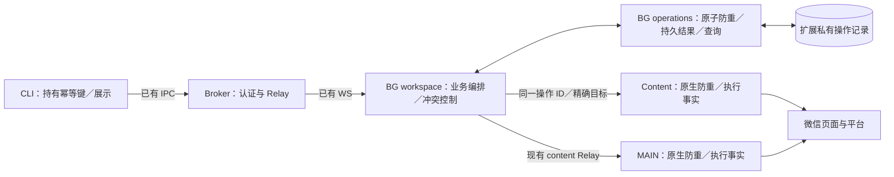
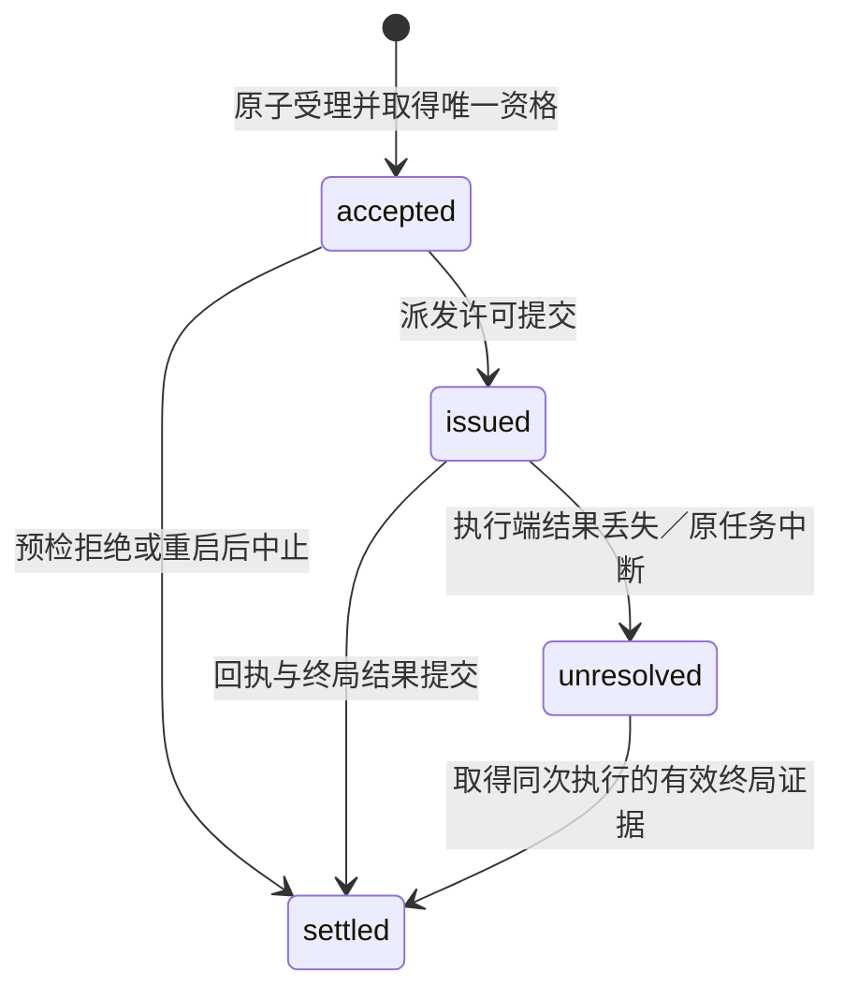
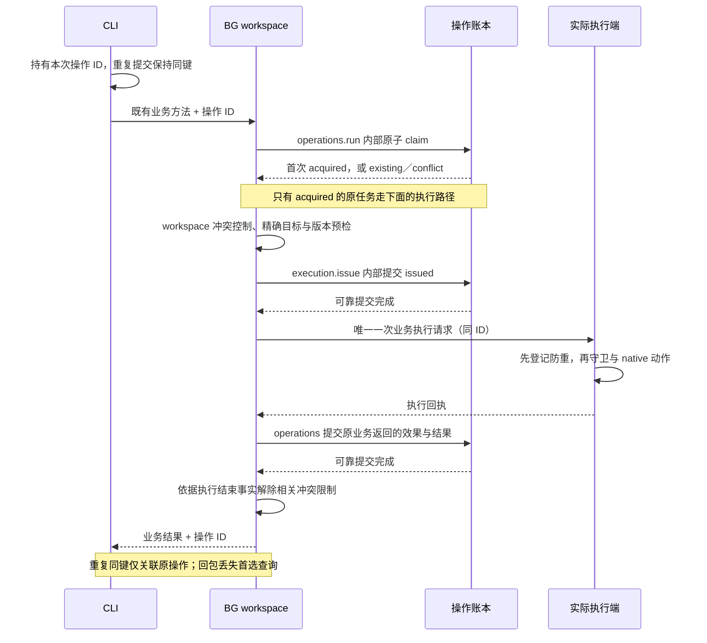

# RFC 0008：分布式执行、幂等记录与异常责任

- 状态：收敛提案；已明确防重模块边界、IndexedDB、BODY 切片与查询语义，未实施。
- 日期：2026-10-10。
- 目的：建立最小完整幂等执行闭环，防止同一次操作重复产生副作用；异常处理围绕执行事实收敛。
- 关联：[通信架构](./0001-communication-architecture.zh.md)、[工程边界](./0005-engineering-and-testing.zh.md)、[发稿准备实施方案](./0007-article-preparation-implementation-plan.zh.md)。本文调整后续执行模型方向，不代表既有实现已迁移。

## 1. 需求与当前事实

### 用户提出的方向

> 我怎么感觉现在出现严重过度工程化的问题呢，但是异常处理的层级是要搞清楚的。
>
> 其实：目前本质上实在维护一个分布式系统，副作用最好要在对应端有幂等记录，比如统一在bg端进行等
> 这和上述的异常处理需要联动

本文的具体字段、持久化选择和并发策略是设计建议，不是已获确认的产品决策。

**BG 持久防重、执行端防重、原结果查询是首版核心，不因简化而降级为日志或“不重试”的约定。** 本版选定原生 IndexedDB，把固定防重顺序封进 BG 内部模块；首个 BODY 切片包含存活原执行端的回执查询。不同操作的冲突仍归 workspace，不引入默认全局锁、CLI 票据库或通用恢复调度。

### 源码事实

| 事实                                                                                    | 当前依据                                                                                                              |
| --------------------------------------------------------------------------------------- | --------------------------------------------------------------------------------------------------------------------- |
| CLI → IPC → broker Relay → WS → BG → Chrome → content／MAIN，最后调用原生页面能力       | `packages/broker/src/server.ts`、`packages/extension/entrypoints/background.ts`、`mp.content.ts`、`mp-main-world.ts`  |
| BG workspace 拥有文章编排；文章引用、素材引用及 document 写队列在内存                   | `packages/extension/src/workspace.ts` 的 `references`、`assetReferences`、`documentQueues`                            |
| 同 document 串行不等于重复请求去重，hash 检查不等于操作身份                             | workspace 方法队列与 MAIN `setContent` 的 check-before-set                                                            |
| BG 重启丢失引用；`current` 可重新观察，但不能复活旧引用                                 | `packages/extension/test/workspace.test.ts` 的 fresh background 场景                                                  |
| 已有持久存储用于配置／受管组／reload 意图，尚无业务操作账本                             | `background.ts`、`connection.ts`、`pages.ts`、`reload.ts`                                                             |
| Nexus `safeGet` 同步检查目录，`safeCall` 消费真实 lazy Remote；它们不提供微信业务幂等性 | 已安装 `@nexus-js/core@2.0.0-alpha.2` API 声明                                                                        |
| 错误经过 pages、workspace、CLI 多次名单映射；部分原生原因仍被折叠                       | `pages.ts:decodePageReply`、`workspace.ts:pageFailureResult`／SAVE `unknown`、`connection.ts` decoders、`mp/jsapi.ts` |

核对时源码协议为 `0.10.0`，真实安装仍是 P71 `0.9.0`。当前隔离 Chromium 最后一次完整结果为 28 通过／1 失败；剩余 BODY 等待期间登录状态遗漏已诊断，未修复。本文不是新的验证结果，也不追溯改判历史 unknown。

## 2. 结论与保证边界

**BG 管“同一操作是否已经取得执行权”，实际执行端管“同一执行是否已经进入原生动作”，异常处理管“当前能证明什么”。** 操作 ID 就是本方案的幂等键，不再增加一个平行的业务键概念。

必须成立的不变量：

1. 同一业务意图在重复提交、超时、断线和重启后保留原键。系统不自动换键；同键不同请求拒绝。
2. BG 原子区分“首次受理取得执行权”与“命中既有记录”。只有取得执行权的原调用可继续；重复调用不能因读到 accepted／issued 就执行。
3. 执行许可可靠落盘后才允许副作用；记录写入失败不派发。记录许可不等于原生已执行。
4. 实际动作入口在执行前登记防重；同键重复到达只关联原任务或原回执，不再次调用 native。
5. 进行中、部分完成和结果未决都不构成重做许可；BG 恢复不重新授权已 issued 的操作。
6. 已保存的效果与结果可按原键查询；失败传播、清理和迟到 timeout 不得降级已确认事实。

这是防重复执行的保证，不是“每次操作一定成功”。无法判断是否已执行时保留未决，不通过重做消除不确定性。

不承诺：

- 微信原生副作用与 BG 存储之间的原子提交或端到端 exactly-once。
- 崩溃后的自动续跑、自动回滚、自动补偿或自动重试写入。
- 不同 ID、不同扩展安装、用户手工操作之间的全局去重。
- 从当前页面内容、同名素材或相同 hash 反推出历史操作的因果归属。

已确认效果不等于整个命令成功；未知不等于没有执行；客户端不再等待不等于远端停止。

## 3. 运行时责任：一个权威账本，执行端薄守卫



| 位置                         | 权威范围                                                        | 不承担的责任                             |
| ---------------------------- | --------------------------------------------------------------- | ---------------------------------------- |
| CLI                          | 持有／传递操作 ID、本地文件事实、交互错误                       | 远端执行状态判定、第二份业务账本         |
| broker                       | 配对、版本、活动会话及 Relay                                    | 业务去重、重发、补猜副作用               |
| BG operations（内部模块）    | 原子匹配请求、唯一执行权、持久记录与查询                        | 判断不同稿件是否冲突、调度业务步骤       |
| BG workspace                 | 不同操作的冲突控制、目标与版本守卫、业务编排、SAVE 原生回执入账 | 从缺失回复推算原生效果、绕过防重直接重做 |
| pages                        | 精确页面／document、连接与服务获取、原生页面生命周期            | 从 transport Err 推断原生未执行          |
| content／MAIN 的实际执行模块 | 局部防重、实际派发、部分修改、确认、局部任务是否还可能继续      | 第二套持久账本、重启接管、宣称 BG 已落盘 |

BG 自己执行的 Chrome 页面创建／reload，也受原操作执行权约束并记录真实结果；不为了对称虚构一个远端 executor。operations 与 workspace 是同一 BG 内的模块责任，不增加进程或 RPC 层。

不新增 daemon、队列服务、任务调度平台、每操作一个 Token 或 Event Sourcing。操作账本是扩展内部模块，不作为 `contracts` 中的存储实现。现有业务方法保持有类型的参数，不改成 `execute(kind, unknownPayload)`。

## 4. 三种身份必须分开

### 4.1 操作身份

对外操作 ID 采用不透明的 `ledgerId + 随机 requestId` 组合；CLI 不解释其内部编码。`ledgerId` 属于本扩展配置空间的账本，持久存在，不随 BG 重启或 WS 重连变化。

- 调用方在业务派发前持有 ID；CLI 接受调用方提供的 ID，也可生成 ID。业务协议必须携带它，不能由 BG 在执行后才生成；本地持久化不是所有命令的强制前置条件，见第 11 节。
- BG 通过现有状态能力发布 ledger 身份，随协调协议更新接入；不新增一次“提交前握手”RPC。
- 账本被清空／重建后必须换 ledger 身份。旧 ID 返回账本不匹配，不在新账本当成新操作执行。
- ledgerId 只防误路由与错误恢复，不是身份认证凭证；查询仍走现有配对／准入。

### 4.2 请求身份

BG 保存可重复计算的 **requestDigest**（操作类型、原输入引用、相关预期 hash、有效载荷指纹），另存首次受理解析得到的 **targetBinding**。二者关联但不混成一个必须重新定位才能计算的 hash：重复提交先用请求本身匹配已有记录，再返回历史结果；只有首次受理才解析活引用。否则 BG 重启后无法解析旧引用，会错误拒绝本来可查询的同一次操作。

- BODY：实际 UTF-8 HTML 字节指纹；不规范化后再判同请求。
- 字段：固定顺序的 present/value 对，区分 omission 与显式空字符串；不使用任意对象键序作为语义。
- 上传：源字节指纹、独立 filename、MIME、大小；同名不是同请求。
- 封面：原 article 字符串、原 asset handle 字符串、预期 coverHash；不解析活引用来计算 requestDigest。素材／文章受管绑定只在首次预检取得，独立保存；thumbnail 不是永久素材 ID。
- SAVE：原输入引用与三个预期 hash；精确目标保存在独立 binding，不把后续 canonical hash 反写成原请求。

CLI 提供的指纹不能直接充当 BG 的校验结果；BG 校验其实际接收参数。MAIN／content 校验分配给自己的局部请求身份。指纹不是密钥，也不是源内容已被平台持久化的证据。

同 ID、不同请求必拒绝；同请求、不同 ID 在协议上是新的意图，不能因为内容相同就吞掉一次用户明确要求的新操作。调用方不能把旧意图换键作为恢复策略。不同键之间是否允许并行由 workspace 判断；参数指纹不承担“猜测两次用户意图是否相同”的责任。

### 4.3 执行目标与历史结果

执行仍绑定精确 tab/document/受管稿件事实，不自动从旧引用跳到新 document。saved 定位也不能脱离账号上下文当成全球唯一 ID；尚无可靠稳定账号标识时，不建立跨账号或跨 document 自动恢复。

操作记录里的目标信息可用于验证历史回执，不用于恢复写权限。查已有 ID 应先查记录，不能因内存 article ref 已失效而丢掉历史结果；新请求仍须校验新引用。

持久结果只存必要效果、hash 和安全的历史摘要。旧 article／asset handle 不作为恢复后的可用能力返回。需要继续工作时，通过独立的显式只读／定位操作获取新引用；不能为了“重放成功响应”自动 open、reload 或上传。

## 5. 持久化、准入与并发

### 5.1 固定防重顺序封进一个模块

**采用原生 IndexedDB 短事务。** 唯一键 claim、owner／state 条件更新由数据库事务实现，`complete` 后才允许下一步；单个 request success 不代表已提交。只有 BG 写一个操作记录 store 和少量账本元数据，不设全 workspace 占用表。`storage.local` 继续用于现有配置，不再并行保留第二套操作存储候选或抽象适配层。

原子 claim 的内部结果仍是 `acquired / existing / conflict`：只有首次取得执行权进入业务回调；同键同请求归并，异参数拒绝；事务失败返回独立 Err。**不把可随意修改的记录交给各业务方法，让它们各自实现状态转换。**

BG 内部最小接口如下，名称为方案示意，不新增公共通用 execute RPC：

| 入口                                          | 固定职责                                                                                               |
| --------------------------------------------- | ------------------------------------------------------------------------------------------------------ |
| `operations.run(request, work)`               | 校验请求身份、原子 claim、关联原任务；仅首次受理调用 work 一次；提交观察与结果，处理原任务退出         |
| work 中的 `execution.issue(binding, action)`  | 核对 owner／accepted，持久提交 issued 后仅调用 action 一次；重复调用此方法拒绝，不再次调用 action      |
| work 中的 `execution.checkpoint(observation)` | 保存已确认中间事实，例如 SAVE confirmed；校验事实只增加、不降级，不创建子任务或续跑点                  |
| `operations.get(id)`                          | 读取已提交快照；不启动 work、不派发 native、不解析已失效文章引用                                       |
| `operations.observe(id, evidence)`            | 将 workspace 已核验的原执行回执按 ID／指纹／绑定合并为新快照；与 checkpoint 共用条件更新，不取得执行权 |

`execution` 只存在于首次受理的原回调内，是带状态守卫的局部执行句柄，不可序列化、不可恢复或凭 ID 重新取得。业务回调返回一份操作专属观察（效果、业务 Result、执行是否已结束的证据）；模块据此提交 settled 或 unresolved，业务不直接写 owner/state。没有 issue 的预检拒绝记录为未派发；issue 后抛异常只能保留已有事实及保守未决，不能统一当作零副作用。

`issue` 在第一个 await 前标记句柄已消费，防止业务误并发调用两次；`run` 跟踪其 action，不能因为外层 work 提前返回就提交终局。回调退出后执行句柄关闭，不允许泄漏引用稍后再次 issue。workspace 在允许同目标后继操作前必须看到相关动作结束及记录提交；不能只靠 `finally` 释放队列就放行。checkpoint 失败时 business 必须停止后续 effectful 步骤；这条顺序保留在业务代码中，不由通用函数偷偷续跑。

示意主路径：

```text
operations.run(有类型的 BODY 请求, async execution =>
  workspace 在相关文章队列内：
    解析首次目标、检查冲突与预期版本
    预检拒绝 → 返回未派发观察
    execution.issue(精确绑定, async () =>
      调用现有 pages／MAIN 写入方法（携带原操作 ID）
      将真实回执解释为 BODY 观察
    )
)
```

小型协调函数封装的是固定防重和存储顺序，不是工作流引擎：队列、冲突判断、预检、native 动作和确认标准均在原业务代码中可见。`issue` 围住该次业务的全部 effectful 路径，允许其中按既有规则执行多步，但不接收步骤配置，不自动重试或续跑。SAVE 的原后续 reload 已按 2026-10-13 决定删除。公共 mutation 入口统一从这条路径进入，测试应证明无直接副作用旁路。

- `existing` 不再次调用 work，也不重复排业务队列；原任务仍活着时复用其 Promise，调用方等待超时不销毁原任务。内存归并占位必须在异步 claim 前建立，且合并前核对该请求指纹；不能只按 ID 返回另一个请求的 Promise，不能因任务 Map 尚未写入而重入回调。
- 数据库临界区只做记录读写，不跨网络、DOM、Blob hash 或 work 回调。长业务执行不持有 IDB 事务或全局记录锁。
- 提交状态不明时不给新执行资格；初始化读取失败／记录损坏／不兼容也不清空继续。BG 重启依据持久记录拒绝接管旧 issued。
- IDB 提交／MV3 生命周期仍须故障注入验证；本选择不承诺跨设备备份或无条件抗磁盘损坏。

### 5.2 不同操作的冲突控制归 workspace

**幂等键解决同一次操作防重；workspace 解决不同操作是否冲突。取消旧稿默认的全 workspace 永久占用。** 原有 document 队列与目标守卫保留，但不足以单独解决旧任务跨 BG 重启继续运行的情况。

| 情形                                     | workspace 的责任                                                        |
| ---------------------------------------- | ----------------------------------------------------------------------- |
| 同键重复提交                             | 先命中原记录；不进入另一份业务排队或执行                                |
| 同一稿件存在仍可能继续的写入             | 保留相关冲突限制；新键不能绕过                                          |
| SAVE 跨 document／引用换代               | 按已验证的同稿身份关联旧记录，不能靠换 tab/ref 摆脱旧执行               |
| 上传／封面共享素材库或对话框             | 依据实际共享页面／账号上下文判断影响，不假设不同 article ref 就隔离     |
| 已证明不相交的稿件操作、纯读取或账本查询 | 不因无关 unknown 默认阻塞                                               |
| 不能证明新操作与旧未决执行相互独立       | 对这个候选操作保守拒绝并指出阻塞 ID／原因；不将缺失身份伪装成已证明冲突 |

检查与进入相关队列／登记执行必须在 BG 中串行协调，不能“先读无冲突，再异步无保护地开始”。BG 恢复先读取未决记录，再允许 workspace 判定新操作；记录是事实来源，不另外复制一个可漂移的持久全局锁。

查询旧记录不改变冲突策略；查询取得并提交了新的有效结束证据时，workspace 才按原策略解除相关限制。旧回执不能清除后来另一操作的占用。每条迁移链路必须证明自己的冲突边界和重启后规则，不把缺口推给未实现的通用锁服务。具体跨稿／共享库身份不足是该链路实施阻塞点，不靠默认全局锁掩盖。

#### 首个 BODY 切片的具体规则

作用范围为已绑定编辑页的正文及同稿完整性；执行不隐含 SAVE、创建页面或上传。继续使用现有 document 队列，向跨文档同稿关联及恢复场景补必要守卫，不新建通用资源锁服务。

| 候选操作／事件                                                     | BODY 仍在执行或结束未证实时                                                                       |
| ------------------------------------------------------------------ | ------------------------------------------------------------------------------------------------- |
| 同键 BODY 请求                                                     | 在 operations 归并，不再次进入队列或 native                                                       |
| 同 document 的另一 BODY、字段、封面、上传／对话框流程、SAVE        | 相关写入／UI 互斥；原任务活着可沿原队列等待，已未决则返回阻塞 ID，不以队列 Promise 退出为释放依据 |
| 同稿的新 ref／新 document、reload、会替换或干扰目标的导航／cleanup | 仍按原稿关联检查；拒绝通过换引用绕过未决记录                                                      |
| 精确现有 document 的纯读取、operation status                       | 允许；普通读取仅表示读取当时的观察，不证明并发写入结束或给旧操作补成功                            |
| 已证明是不同受管稿件，且不操作原页／共享 UI 的 BODY 写入           | 允许独立执行；只有 SavedID 字符串不同或 tabId 不同但上下文不明，不足以证明隔离                    |
| 原目标身份／同稿关系无法确认                                       | 拒绝这个候选修改并说明关系不明；不把所有只读或已证实独立的工作一并封锁                            |

BODY 的释放依据限于原执行事实：派发前明确拒绝且无后续动作，或原 JSAPI 完成语义与对应执行端结束事实成立。完整成功还要求同一受检目标上的实际回读／hash。callback 的错误语义未证实、callback timeout、RPC 断线、单次内容相等、document 消失本身都不自动释放。明确知道写调用已结束但回读失败时可以结束为失败；不能编造 bodyHash 或确认效果。BG 重启先从记录恢复待判定集合，再开放相关候选写入；查询有效原回执可解除已结束任务的限制。

这张表同时约束现有旧路径，不能让旧 SAVE／reload 绕过新的 BODY 防护。字段、上传、封面、SAVE 的迁移各自补充同样规模的“影响对象／冲突候选／结束依据”表；不在本文预造所有资源的锁图。

### 5.3 去重覆盖范围

第一批业务迁移覆盖 BODY push、字段 update、asset upload、cover set、SAVE。`article new/open` 的页面创建也属于副作用，最终应纳入操作记录；在其迁移完成前继续沿用 P71 身份唯一及 pageCreated 语义，并明确没有账本去重保证。

同一已迁移副作用不能仍有无键旧入口绕过防重。其他旧业务路径也必须尊重 workspace 的相关冲突约束；尚不能协调的路径在切片验证中隔离，不能发布一个宣称完整防重但实际存在旁路的版本。`list` 的隐含页面创建／刷新、`workspace cleanup`、显式 reload 都要审计；打开素材对话框等“读命令”也不能因名称是 read 而绕过相关 UI 冲突。普通只读结果与本地文件输出不一律入账本。

**防重粒度为一次业务操作，不是每个 DOM 步骤。** 字段 partial 失败后同键返回原事实，不重跑整批或继续未完成字段；上传同键不再次触发 change；SAVE 同键不再次点击或 reload。保留阶段证据，不建立可恢复的子任务图。

## 6. 操作状态与效果证据

### 6.1 四个记录状态

| 状态         | 含义                                                                      |
| ------------ | ------------------------------------------------------------------------- |
| `accepted`   | 已持久受理，唯一原任务持有继续执行资格；尚不允许原生副作用                |
| `issued`     | 派发许可已持久提交，原执行可以继续；不证明 native 已执行                  |
| `unresolved` | 原执行的结果或结束事实仍缺失；同键不补派发，由 workspace 保持相关冲突保护 |
| `settled`    | 已有持久化终局结果，且满足该操作的执行结束条件；同键只返回原结果          |



没有 `unresolved → issued` 或自动 resume。已记录的 `settled` 不因后来读取失败、TTL 到期或 cleanup 出错被重置为可执行。

BG 每次启动有自己的任务 owner 标识，并随 claim 保存；这是区分活任务与旧记录的内部事实，不作为新的公开身份或租约。`accepted` 若仍由本实例任务拥有，同 ID 关联该任务；若属于已结束的旧实例，因未获派发许可，可转为 `settled` 的“中断且未派发”。旧 `issued` 恢复为 `unresolved`，不接管执行。初始化完成前不开放写准入。

CLI 超时／退出或 WS 断开本身不将活操作改为 unresolved：原 BG 任务仍可能继续并正常提交结果。只有该次执行确实丢失可判断的结果／结束证据时才记录 unresolved。一次查询失败也不改变操作状态。

accepted 阶段只允许无副作用预检。打开对话框、hover、创建页面、reload 等也受 issued 前置提交约束，即使主要业务效果还未派发。`effect.not_dispatched` 只描述对应正文／上传／保存等主效果，不能解释成页面没有任何变化；必要的 pageCreated／自有 UI 清理事实独立保留。宁可提前标记 issued，也不能把已有外部效果的记录留在可宣称零动作的 accepted 状态。

### 6.2 副作用不是记录状态

`issued` 是 BG 的程序进度；效果事实另记为有操作判别的类型：

| 操作               | 需要保留的证据                                                             |
| ------------------ | -------------------------------------------------------------------------- |
| BODY               | 未派发／未知／确认；实际回读 bodyHash；不表示 SAVE                         |
| 字段               | 未派发／部分／未知／确认；实际 confirmed／unknown 字段子集，不补未尝试字段 |
| 上传               | 未派发／未知／创建确认；确认依据仍是现有原生观察，不升级成源字节持久化证明 |
| 封面               | 未派发／未知／回读确认；coverHash 与必要基线                               |
| SAVE               | 原生保存效果与 persistence verified/unverified 两条独立事实                |
| 页面创建（迁移后） | 实际 pageCreated 与引用绑定是否完成；不等同于云端新建草稿                  |

`settled` 可以是业务失败，例如 content_conflict、已知部分修改后中止；它不等于成功。返回了函数 Err 也不自动等于 settled：若平台操作／迟到回调仍可能继续，必须保留 unresolved。

“执行收敛”需由对应操作说明：不会再由这次任务发出新的 native 动作，且其异步动作已有符合现有确认标准的结束事实。RPC timeout、JSAPI timeout、连接 dispose、队列 Promise 完成、人工看到相同内容，单独都不是证明。

反过来，**历史效果 unknown 不必永远等于执行仍 unresolved**。若有独立可靠证据证明旧执行和它发起的异步动作已结束，但无法证明效果内容，可以 settled 为“效果未知的失败”，保留历史 unknown；workspace 据此评估解除相关限制，之后的新操作仍须显式新意图、当前引用和 hash。不能为恢复可用性把未知效果改成 confirmed，也不能只因未知效果就无条件阻塞所有未来操作。settled 从不让同键重新取得执行权。

### 6.3 内部记录的最小字段组

```text
OperationRecord（仅扩展内部）
  schemaVersion, requestDigest
  targetBinding?, executorBinding?      // 首次预检取得；issued 前必须固定实际执行目标
  owner                                // 内部任务所有权，不是租约
  snapshot                             // 第 10 节的单一操作快照，含唯一一份 state
  createdAt, updatedAt                 // 观测用途，不作为 lease 或重试许可

LedgerMeta
  ledgerId                             // 无全局 activeOperationId
```

这是字段分组，不是完整 TypeScript schema。正式记录只在 snapshot 内存一次 id／operation／state／effect／result；外层 owner 和 bindings 是私有执行元数据，不再复制一份业务结果。用 state／operation 判别约束必须字段，避免任意 optional 拼接。claim 可以先记录请求身份，尚未解析活引用的 accepted 不伪造 binding；issued 前必须固定这次实际执行所需的目标与生命周期约束。字段集合只允许被证据推进，不能凭状态转换推算。

## 7. 正常调用与所有崩溃窗口



| 中断点                     | 持久证据与恢复行为                                                                         |
| -------------------------- | ------------------------------------------------------------------------------------------ |
| ID 尚未生成／传入          | 不提交无键业务调用                                                                         |
| claim 提交前               | 没有派发；存储错误不产生业务效果                                                           |
| claim 已提交、客户端未收到 | ID 已存在，后续查询可见；不能凭客户端 timeout 判断未受理                                   |
| accepted 后、issued 前     | BG 重启可以证明本次尚未获得派发许可；中止并记录未派发，不自动续跑                          |
| issued 后、真正发送前      | 可能零 native 调用，但重启无法证明；保持 unresolved，牺牲可用性避免重复                    |
| native 执行后、BG 收回执前 | 执行端如仍存活可提供同 ID 回执；否则 unresolved                                            |
| BG 收到确认、记录提交失败  | 保留当前进程已观察确认；不能报告“未执行”或声称已持久。同键不重做，相关冲突不因提交失败消失 |
| 终局提交后、CLI 收到前     | 同 ID 查询返回持久结果，不执行原命令                                                       |
| 查询本身断线／非法回包     | 查询交互失败，不能据此改变操作记录                                                         |

**2026-10-13 SAVE 职责变更（协议 0.14.0，ledger schema 2 不迁移）：** 删除原生确认后的列表刷新、canonical／漂移读取、reload 与 fresh 三 hash 核验。原生回执经过原 operation/executor/digest 校验后，直接交原账本最终事务；confirmed/ended/result.ok 可成功且 persistence unverified。存储失败保留 uncommitted 确认，不重试 SAVE。其他业务必要的中间 checkpoint 不受此删除影响。

新 SAVE 没有额外 BG 导航义务，仍须原生 ended 与自有 cleanup 收敛，不能只凭 confirmed 成功。历史 SAVE 的 bgEffects pending／首因／state 保留，不因新语义补判旧导航；旧 verified 效果可读且不降级。纯 status 只能接纳原 executor 的证据，不能从旧 nativeok 补造原 BG 返回成功已提交。BG 中断而最终结果未提交时可保留 confirmed 的失败终局；旧 pending 仍 unresolved，不续跑、不重读 DOM。

若记录更新失败的提交状态不明，重新读取记录／保存同份回执属于存储恢复，不是业务重试；必须有界且不能顺便重发 native 请求。该操作不能再次取得执行权，受影响的新操作不能因记录错误被放行；若整个账本不可读，必须拒绝依赖它的新副作用。

## 8. 实际执行端的薄守卫与回执

**实际副作用边界的防重是首版保证，不以“BG 当前不会重试”替代。** 本方案采用 provider 内的薄守卫，不在每一跳复制持久状态机：BODY 放在 MAIN editor service，DOM 操作放在实际拥有动作的 content provider；broker 与 content BODY Relay 都只转发。

执行端本地条目仅包含操作 ID、局部请求指纹、目标／执行绑定、进行中任务或原生回执。

1. 先验证基本输入与调用来源，**在第一个异步让出或 native 动作前同步占住键**。需要异步计算请求指纹时，匹配过程也必须经过该占位；不能两个请求 hash 完再各自执行。
2. 同键同请求只关联原任务／返回原回执；不同请求拒绝。查到已完成条目时不先重新检查旧 hash 或重跑 DOM 步骤。
3. 一次业务调用内部仍可顺序做必要步骤；部分失败后不恢复循环或执行未尝试字段，不给每个 DOM 步骤生成子任务键。
4. 存活执行端保留回执作为证据来源，但不宣称 BG 已持久化。完整回执可裁剪，防重标记在该执行生命周期内不能丢；容量不足拒绝新执行，而不是清空表。
5. 原生任务超时不清除防重条目。可信迟到回执只能增加证据，不能触发已中止的后续字段写入、SAVE reload 或清理点击。

### 8.1 生命周期边界必须闭合，但不预造一套身份系统

持久防重由 BG 负责，局部表负责本次执行生命周期；不能把新 document／重新挂载 provider 的空表当作旧操作未执行。

- 优先复用已有精确 document、受检 Nexus session 与 provider 生命周期约束。需要验证旧 Remote 在 session 更换后不能重新绑定到新 provider，以及同 document provider 重挂载的实际行为。
- 若现有绑定不能区分替换后的执行实例，则仅增加必要的执行实例 nonce：BG 在 issued 前绑定该实例，接收端在原生动作前检查；替换实例拒绝旧调用。不预先强制铺设 DOM ID／BODY ID 的多级 metadata 传播体系。
- 不论采用哪种绑定，都必须以同 document 重挂载／旧请求迟到用例证明防重。证明缺失是实施阻塞，不是允许省略该保证的理由。
- BG 从不重新授权已 issued 的操作，也不为了核对结果再次调用 execute。旧回执只能绑定到原 ID／请求／执行目标，不能作为新实例的执行许可。

### 8.2 BODY 切片包含存活执行端的回执查询

首个 BODY 切片在原 MAIN editor provider 增加 `getReceipt(operationId)`。它只读取局部防重条目和已保留回执，不调用 JSAPI、不重新读正文、不打开页面，也不创建不存在的条目。回执含原请求指纹／执行绑定，接收方校验后使用；当前版本准入仍成立。

公开入口仍只有 `operation status <id>`，不再增加 reconcile 命令：

1. 先由 `operations.get` 读持久快照。读取失败返回交互 Err；读取成功不要求原 article ref 仍有效。
2. 对 unresolved 的 BODY，如能定位并核对原执行实例，workspace 做一次有界只读回执查询；不重新绑定到新实例，不轮询 execute，不触发导航或 JSAPI。该路径只获取已有受检 provider 的 receipt 方法，不能复用会调用 editor.ready／getContent 或等待新 MAIN 发布的 pages.open 工作流。若现有 Relay 的 policy 不允许访问原端，返回不可达事实，不放宽写入准入。
3. 得到合法同次回执后，workspace 按 BODY 规则解释结束与效果，再交 `operations.observe` 条件合并并提交；若已结束，更新结果后 workspace 可解除相关限制。只是运行中则不制造终局。原 `run` 仍活着时，局部回执不能越过尚未结束的外层编排抢先提交整个操作终局。
4. 原端消失、条目缺失、绑定不明或查询失败时仍返回已提交 unresolved 快照，不能降级已有事实、丢掉原结果或重做动作。必要时在查询回复附当前交互诊断，不回写成原业务失败。

**这条命令对业务副作用只读，但允许补充 BG 账本证据。** `operations.get` 本身始终只读数据库，读取与回执核对由 workspace 明确编排。账本查询必须有独立时限，原端不可达不能无限拖住查询。BG 重启后若原 MAIN 仍活着且原身份可验证，可取回其结果；不能取到的仍是未决，不声称跨页面恢复。

`getReceipt` 是 native 观察，不自带“整个 workspace 操作已结束”的含义。BODY 的结束由其操作规则解释；新 SAVE 只以原 native ended／cleanup 判断原生结束，不补造未提交 BG 成功。历史 SAVE 的 pending reload／核验责任仍不能凭 native-confirmed 解除。回执解释集中在原业务拥有者，不在通用记录模块靠错误码推算。

原生 Promise timeout 与迟到证据观察分开：当前 JSAPI `finish` 丢弃迟到 callback，BODY 切片要让有效原回调补充局部记录，而不重新进入已停止的业务步骤。callback 不足以证明结果时保留 unknown；不能仅为凑确认而重新调用写入或猜测正文。provider 存活期间只保留必要回执与防重标记，不添加永久 watcher。

合并回执遵循相同 ID／指纹／绑定和信息不倒退规则；重复回执不新增效果，矛盾回执报告协议问题而非 last-write-wins。合法终局后不按当前页面重算。旧回执不解除别的操作的冲突保护；独立 CLI cleanup 不回写业务记录。

## 9. 恢复边界：保持同键，不接管执行

| 恢复情况                          | 行为                                                                |
| --------------------------------- | ------------------------------------------------------------------- |
| 原 BG 任务仍存活                  | 重复同键关联原任务或读取记录；客户端超时不取消它，也不启动另一份    |
| BG 重启，旧 accepted 未获派发许可 | 保存中断／未派发结果；同键不能作为新请求重新执行                    |
| BG 重启，旧 issued 或 unresolved  | 保留原记录，不重新授权；有原回执才补充证据                          |
| 执行端仍在继续                    | workspace 阻止相关冲突操作，不能凭 RPC timeout 释放                 |
| 页面／provider 已替换             | 不迁移执行，不根据空表补派发；旧记录仍可查                          |
| 旧执行已证实结束但效果未知        | 可以保存 unknown 失败终局；workspace 决定解除相关限制，同键仍不重做 |
| 原执行是否结束无法确认            | 保持未决及必要冲突限制；独立查询和已证明不冲突的工作不默认被封锁    |

本方案不添加 lease 过期接管、自动续跑、补偿或默认 force-unlock。新键不能被系统用作旧意图的恢复手段；用户确实发起新意图时，仍受当前目标/hash 和 workspace 冲突策略约束。不同键并行规则的证据不足，需要在该业务迁移时补齐，而不是以全局永久锁替代设计。

## 10. 异常模型如何随执行模型收敛

### 10.1 两个结果，不混为一谈

- **交互结果**：这一次 submit／status／receipt 调用是否成功得到合法响应。Nexus Err 与 codec Err 属于此处。
- **操作结果**：账本中该 ID 的状态、已确认效果和业务结果。即使 CLI 已断线，仍可继续形成结果。

`operation status` 查到一个失败操作，应是查询 `Ok(snapshot)`，snapshot 中含失败的业务 Result；这不是把业务失败改成成功。查询可按第 8.2 节核对原 BODY 回执并返回新提交的快照。查不到／读存储失败／账本不匹配属于查询 Err。Nexus 外层 Result 仍先于业务 codec 处理。

### 10.2 两种视图，一个错误定义

对外只有已提交操作快照与本次交互问题，二者共用小型 `Failure`，不再设置 snapshot.failure、terminalResult、recordFailure 等平行容器。示意如下，具体机器码从真实边界提取：

```text
Failure
  code
  cause?   { at, kind, code }
  cleanup? { at, kind, code }       // 同一责任内首个后续清理失败

OperationSnapshot（按 operation 与 state 判别）
  operationId, operation, state
  effect                            // 操作专属事实，只存此处
  accepted / issued: 无 result      // 正在执行；已确认的中间事实可写入 effect
  unresolved: result = Err(Failure) // 当前缺失结果／结束证据的原因
  settled: result = Ok(summary) | Err(Failure)

InteractionIssue
  operationId?
  failure: Failure                  // 本次调用／记录提交／资源清理的问题
  uncommitted? { effect, result? }  // 仅实际收到但未能持久保存的原生观察
```

`summary` 只放未在 effect 中出现的必要返回数据，允许为空；不重复 bodyHash、字段名单或 SAVE 确认位。内部执行结束证据由业务解释并用于决定 state，不另造一套公开任务状态。未提交观察沿用相同 effect／Result 形态，不是新的副作用类型。

不变量：业务主错只在 `snapshot.result.Err` 中出现；本次存储失败只在交互问题中出现；操作效果只在 snapshot.effect 中出现。未提交观察明确不属于持久 snapshot，可以与旧 snapshot 不同但不能冒充已落盘。因查询失败而得到的交互问题也不能被写成操作失败。

正常查询返回 snapshot；已取得 snapshot 后，辅助回执查询／连接清理若失败，回复可以同时保留 snapshot 与一个 `InteractionIssue`。snapshot 不可读则只返回交互 Err。这是一条数据通路的两种事实，不是让 provider/pages/workspace/CLI 各造一个错误封套。CLI 顶层退出码按当前命令完成标准判断：查询取得快照不代表所查操作业务成功，修改成功也不能用交互成功代替。

`at` 是有证据的语义位置，例如 `bg.page_call`、`main.jsapi_callback`、`bg.persistence_read`。只从实际 emitters 建立有限字面量，不预铺完整调用栈、不拼任意 message。`kind` 为 domain／nexus／protocol／runtime，是原因类别，不代表责任层。

真正独立的业务事实保留：字段 partial 子集、上传创建确认、封面回读、SAVE persistence。它们不再各自复制 workspace_call/page_decode/broker_cleanup 的整套异常体系。不持久化七个可同时出现但含义冲突的 `*Failure` 容器。

### 10.3 转换规则

| 位置                                    | 规则                                                                       |
| --------------------------------------- | -------------------------------------------------------------------------- |
| 外部文件／Chrome／Nexus／JSAPI 边界     | 把实际异常转为有限机器码；不输出原 message、stack、认证 URL 或 token       |
| 合法业务 Err 经过 pages／workspace／CLI | 默认保留；只有词汇边界变化时作一次明确映射，不能每层重新列白名单           |
| 原生执行端                              | 把实际派发、确认、部分结果写入回执；不能由请求 keys 生成事实               |
| BG 后续核验失败                         | 新增当前原因，保留已有 effect；SAVE confirmed 不降级                       |
| CLI／broker 清理失败                    | 属当前交互／资源清理，不篡改已持久业务结果；CLI 显示两者                   |
| BG 自有对话框／pointer 清理失败         | 保留首个业务错误和效果，另记清理；只有主流程本来成功时清理成为命令失败原因 |

不能用 object spread 直接暴露任意内部对象。安全 codec／投影放在真正出站边界；同一条已验证公共结果不重复手工挑字段。内部调试日志不是公共因果证据，不能泄露敏感信息。

### 10.4 三个完整例子

**CLI 上传超时，但 BG 已提交创建确认。** CLI 返回调用超时及操作 ID，暂不能判业务结果。重连查询同 ID 获得 confirmed 历史结果；不再次上传，不靠同名卡片认领。

**历史 SAVE 已确认，fresh BODY 调用超时。** 原 BG 的 native confirmed、persistence unverified 和原 cause 保持，不能包装成“有没有保存都不知道”，也不能因新职责删除而补判旧导航结束。新 SAVE 不发 fresh BODY 调用；原 native 确认／清理或最终入账失败保留实际首因，不自动再次 SAVE。

**原生派发完成，但回执持久化失败。** 当前交互报告记录写入失败，`uncommitted` 保留已收到的 effect 与原业务 Result；持久快照仍可能只有 issued/unresolved。同键不能重做，相关冲突不能因此被放行。若原业务 Err 已存在，它仍保留为该业务结果的主错误；存储失败描述本次提交失败，不覆盖或改写它。CLI 能明确表达“观察到了什么、哪些尚未保存”，不宣称以后一定能查询到未提交事实。

## 11. CLI 与恢复接口的最小形态

首版公共面只增加：原修改命令的 `--operation <id>` 和 `operation status <id>`。自动化调用方应在调用前保存自己提供的键；普通 CLI 可缺省生成，并在成功／失败结果中携带同一个键。wire 修改请求必须有 ID，BG 不能替缺键调用先执行后补号。

- CLI 不因超时、断线、record not found 或重启自动生成替代键。同键重复请求由 BG 原子归并；不是只靠 CLI 避免调用第二次。
- 自动生成 ID 时，在首次派发前通过明确的 stderr 请求标识输出它，保持 stdout 单个结果 JSON。`--quiet` 可抑制等待提示，但不能隐去这个恢复所需标识。成功／失败最终结果仍带该 ID。
- **撤回强制本地票据数据库及 `operation list --local`。** 不把新的本地磁盘写入作为所有业务的必经依赖。没有自行保存键、且进程／输出在硬终止时丢失，首版不保证找回该 ID；这会损失可查询性，但不清除 BG 的防重记录，也不允许换键盲目重做。
- 查询沿现有 Workspace Token 提供；先取账本快照，不要求原 article 引用仍有效、MAIN 就绪或页面仍打开。对 unresolved BODY 可按第 8.2 节有界读取原端回执并补记证据；原端不可达仍可返回历史快照，不触发导航。
- 原修改命令在已有时限内等待原任务结果；未取得终局则非零退出并带 ID。相同键的第二个等待者可以先超时，不能取消第一个任务。不是新的后台任务调度 API。
- 终局查询返回历史效果与业务结果；旧能力引用不重新赋权。部分／未决结果仍明确，不一律包装成成功。
- 查询优先于重跑带文件参数的命令，避免源文件已变导致同键参数冲突。显式同键重复提交受支持且必须防重，但不配置自动业务重试策略。
- 原生回执核对是 provider 的只读能力，经同一个 status 命令有界调用；不新增通用 reconcile、resume、force 或补偿命令。

## 12. 保留期限、容量与账本丢失

### 12.1 当前策略：保留防重记录，不自动裁剪

采用 BG 权威的键代际，不建立永久增长的 tombstone 库。`op:<keyLedgerUuid>:<nonceUuid>` 格式不变；连接 metadata 的 `ledgerId` 标识一次存储安装。**遵循原 §4.1，不新增提交前握手 RPC**：既有 control.getStatus 只读 BG 当前已提交的 `keyLedgerId`，broker 经已准入的精确会话转给已有 connection.getStatus，CLI 从本来就调用的准入 status 生成键，不额外向 Workspace 取键。旧会话回复必须重新核对 session/安装/version，broker 不缓存异步代际回包，不能覆盖继任会话或之后的查询。status/operation status/显式旧键的共用连接检查均不裁剪、换代或触发业务动作；旧 metadata 不是新键授权，claim 仍核对已提交的代际。

撤销自动达到 10,000 条裁剪到 5,000 条及随机键代际轮换。单篇准备没有要求自动遗忘操作结果；为此增加容量扫描、删除事务、代际轮换和跨端回收测试没有实际必要性。新 claim 只原子检查原键／参数、持久受理，不扫描或删除全部历史。浏览器 quota／事务失败返回 storage_failed，在受理完成前不执行 work／native。

已有 meta.keyLedgerId 和历史记录继续严格解码，不迁移、清库或回写旧键。已有旧代记录仍同键防重；不存在的非当前代键仍报 ledger_mismatch，绝不重新受理。当前代不存在键报 operation_not_found，但不能据此推断未派发或换键重试。停止后续轮换不意味着此前被遗忘的键重新有效。

存储布局沿用 IDB 数据库 version1、两个 stores；记录/meta 的 schemaVersion2 单独严格检查，旧1/未知/损坏保留并报 `ledger_incompatible`，不隐式迁移或清库。每个记录保留安装 `ledgerId`，支持多个有效历史键代同时查询。初始化原子设置最新 owner 并按既有规则中止 accepted/保留 issued 为 unresolved；所有 claim/issue/checkpoint/observe 与新键获取核对持久 owner。被替换 owner 不能继续授权派发或提交；已经发出的 native 可能继续，原结果仍可由当前 owner 经原绑定 receipt 核对，未决不因 fencing/GC 消失。

事务 abort/quota 保留旧记录，新副作用必须取得 claim/issue complete，不能拿 request success 当许可。初始化和 workspace pending 读取严格验证历史记录；新 claim 核验自己的原键记录，不额外扫描整个历史。清存储/重装生成新安装/键代 UUID，旧键不受理，也不自动认领旧页面。ledger_mismatch 不证明旧动作没发生。IPC workspace reader/writer 与 WS 双向 provider 仍严格版本检查，旧客户端仅可读取诊断 status。

- 未决记录不自动到期；是否仍限制其他操作由 workspace 根据执行事实判断，不能把记录 TTL 当作旧任务结束证明。
- **已消费的键不能因 GC 重新成为首次请求。** 首个验证切片保留防重记录，不先实现自动清理。完整结果裁剪与防重标记保留是不同动作；裁剪后只能返回结果已裁剪，不能重新执行。
- 后续保留策略必须二选一并证明：保留可防重的最小 tombstone；或者建立明确键有效期／账本代际，所有被遗忘旧键都被拒绝为过期。不能只删记录再继续接受同格式旧键，不依据未经验证的客户端时间直接判安全。
- 不为假想容量预先实现回收策略。实际存储失败需保留旧键且零新增副作用；若以后有明确历史删除需求，再决定其产品承诺与旧键防重。
- 同一账本 `not_found` 仅表示查询时未见提交。原 submit 可能仍在传输；不能据此换 ID。将来若重新提交同 ID，其 claim 才决定首次受理还是命中既有记录；没有客户端自动重试策略。
- 用户清扩展数据／重装／切 profile 可能使账本失去；旧 ID 不能在新 ledger 被接受。丢失账本不证明历史操作未执行。新环境也不自动认领旧页面、恢复旧 pending 操作或生成替代请求。

## 13. 与既有代码及协议的迁移

1. **先关闭当前真实回归。** BODY 等待期间登录变化需在原边界正确观察；这属于现有行为修复，不要借机引入账本或新错误框架。
2. **一个最小完整纵向切片。** 以 BODY push 验证稳定键 → IndexedDB 原子 claim／issue → MAIN 防重 → 原生事实 → BG 快照保存／查询。包含原端存活时 getReceipt 找回丢回复结果和第 5.2 节冲突表；并发重复、丢回复、BG 重启和 provider 更换均以原生调用计数和实际内容验证。
3. **迁移真实差异。** 字段 partial、上传平台副作用、封面清理、SAVE confirmed/persistence 分别接入同一记录骨架；业务控制保留在原 helper／workspace，不包装成通用步骤执行器。逐条完成后删除对应重复错误转发，不同时保留两套权威模型。
4. **逐链路闭合冲突与导航。** 相关未决执行对新操作的影响、`new/open` 页面效果、SAVE reload、list 隐含导航、cleanup 和显式 reload 必须有准入规则。保留能证明安全的不同稿件并行，不默认全局永久锁；不能以延后冲突设计放行已知可能冲突的写入。
5. **协调发布。** 操作 ID／查询／错误 shape 是新的协议契约，不能当现有 `0.10.0` 的兼容小改。使用现有精确版本准入安排下一版，CLI、broker、extension 同步；不新增协商协议、不接受旧无 ID 写入绕过准入。

账本本身单独版本化；未知记录版本拒绝恢复写入，保留数据。部署前的历史 unknown 没有操作 ID，不补造记录、不回填成功、不重放。新源码、构建、实际加载版本仍须区分。

建议落点：扩展内部一个 `operations.ts`（确有需要再分存储模块），通过 run／issue／checkpoint 和快照读写封住固定防重顺序；workspace 拥有不同操作的冲突控制、原生回执解释及业务步骤；content／MAIN 在原 provider 内增加薄守卫与 getReceipt；contracts 只定义 wire；CLI 管键的传递与展示；broker 保持 Relay／状态接入。允许深模块减少固定胶水，不预建 manager/repository/service/factory 四层，不在 run 中隐藏业务调度、重试或恢复策略。

## 14. 故障注入验收矩阵

| 场景                                                  | 必须证明                                                                                        |
| ----------------------------------------------------- | ----------------------------------------------------------------------------------------------- |
| 并发相同 ID，相同／不同请求                           | 只有首次 acquired 执行；existing 不能继续，异参数明确拒绝                                       |
| 已 claim 的 owner 误调用两次 issue、work 提前退出     | action 最多一次；不能提前提交终局或泄漏句柄后来派发                                             |
| 原生入口收到重复同键调用                              | 一份 native 执行，关联原任务或原回执；异步 hash 不留下重复进入窗口                              |
| 并发不同 ID，修改同一或不同稿件                       | 相关冲突由 workspace 阻止；已证明独立的操作不因无关未决被全局封锁                               |
| claim／issued 提交失败、提交点前后断进程              | 派发前写失败零调用；提交状态不明不授权；issued 恢复不补调用                                     |
| native 后切断任一回复边界                             | status／receipt 能恢复已有事实，或诚实 unresolved；native 计数不增                              |
| BODY 已结束且原 MAIN 存活，原回复丢失                 | status 经 getReceipt 提交原回执并解除相关限制；JSAPI 调用计数不增                               |
| getReceipt 失败／缺失／回执提交失败                   | 保留旧快照与必要交互问题；缺失不补执行，未提交观察不冒充持久结果                                |
| BG suspend／restart，旧 executor 仍运行               | 不接管重发；相关冲突的新 ID 被挡；旧有效回执可归并                                              |
| executor document 更换／同 document provider 重新挂载 | 旧执行实例不能变成新执行权限；receipt 缺失不是未执行                                            |
| 确认后落盘失败、清理又失败                            | 确认与首错都不丢；同键不再执行，相关冲突不被错误放行                                            |
| SAVE native 确认后 crash／最终提交前 crash            | 原回执可增加确认，但不补造 BG 成功；无后续导航／重做，persistence unverified；旧 pending 不解锁 |
| BODY／字段内容恰好相同、素材同名                      | 不据此给未决操作补 confirmed                                                                    |
| 迟到低信息错误／矛盾回执                              | 不降级已确认事实；冲突不 last-write-wins                                                        |
| full result 裁剪、容量满、账本换代                    | 不把旧 ID 再当新操作；没有静默 GC 重放                                                          |
| CLI 超时／退出，原 BG 任务仍继续                      | 不把客户端结束写成业务失败；原任务仍可形成已提交结果                                            |
| CLI 在回复前被终止，调用方持有原键                    | 同键查询／重复提交不新增 native 调用；无键时不声称必然可找回                                    |
| 新旧协议混连、旧写方法直达 provider                   | 准入拒绝；无兼容旁路副作用                                                                      |
| 只读与带隐含 UI 的读取                                | 真正只读保持可用；导航／dialog 不绕过相关冲突准入                                               |
| accepted 后的 effectful 预检                          | 对话框／hover／页面创建之前已经提交 issued，不错误恢复为零动作                                  |
| 原 BG 与回执查询同时观察 SAVE 确认                    | 活 owner 不被查询抢占；新 native ended/cleanup 与最终提交分开，旧 pending reload 不误判结束     |
| 旧回执晚于新的冲突操作到达                            | 不能回退终局或清掉另一个 ID 的保护                                                              |
| 部分字段失败后重复同键                                | 不重新跑整批，也不继续未尝试的字段；返回原部分事实                                              |
| 操作完成后原 hash／article ref 已失效                 | 同键先匹配历史记录，不重跑首次预检；历史结果不复活旧 handle                                     |
| 封面旧 asset handle 无法重新解析                      | 重复请求仍可按原输入计算指纹；只有首次预检需要活素材绑定                                        |
| JSAPI callback 晚于本地 Promise 超时                  | 可保留可信迟到证据，但不会恢复任何已中止的后续写步骤                                            |

使用真实 Nexus lazy Remote 与隔离 Chromium 跨 world 证据。不能只测序列化快照或复制实现的字符串断言。真实账号写入、权限扩展及生产部署仍另行授权；本方案不新增授权。

## 15. 本次 code-design 收敛与实施前验证

本节为主会话设计校核，不冒称独立 reviewer 或运行时验收。

| 项目                    | 修订结论                                                                                  |
| ----------------------- | ----------------------------------------------------------------------------------------- |
| 幂等键与 BG 持久记录    | 保留为核心；防副作用重复，不是仅做日志或标记 unknown                                      |
| 实际执行端防重          | 保留薄守卫；不靠“不自动重试”的调用约定替代                                                |
| 同键执行权              | claim 与状态更新封在 operations；只有原回调拿到一次性 issue，重复请求不能接管 accepted    |
| 全 workspace 持久锁     | 撤回默认设计；业务冲突由 workspace 依据实际目标／共享资源控制                             |
| 每 DOM 步骤的幂等子任务 | 不建设；一次业务执行，记录必要部分事实，不自动续跑                                        |
| 执行实例 ID 体系        | 先验证既有绑定，只有生命周期缺口才增加最少 nonce                                          |
| IndexedDB               | 选定原生短事务，存储 claim／条件更新；不实现双存储适配器                                  |
| 强制 CLI 本地票据库     | 撤回；调用方持有键，CLI 明确输出。硬崩溃后无键找回不是首版保证                            |
| 回执恢复                | BODY 首切片包含 getReceipt；status 可有界补记原回执，不新增 reconcile／接管／重做         |
| 永久增长与 GC           | 不默认构造永久存储策略；任何回收都必须保证旧键不会再次被接受                              |
| 异常模型                | 单一 OperationSnapshot 与 InteractionIssue 共用 Failure；效果和业务主错各只有一个权威位置 |

必须在实施中闭合的证据：

- IndexedDB 在并发 claim、提交失败及 MV3 重启后的唯一执行权；原生动作只在 issue 提交后执行。
- 旧 Remote／同 document provider 重挂载时不能再次执行旧请求；不足时补最少实例约束。
- BODY 冲突表与原端 getReceipt 在完整链路成立；后续业务分别核对实际派发点、部分效果和结束证据。
- 有限容量下防重记录仍有效；保留／过期／账本换代不会让旧键重新执行。

**首版是否成立看四项：并发重复零新增执行；成功但丢回复零重复副作用；BG 重启／页面失效不重新授权旧操作；未知／部分／清理失败保留原事实。** 在此基础上减少错误转换与调用方知识，不以少写一个守卫换取表面简单，也不以增加阶段和状态数量冒充完整。
